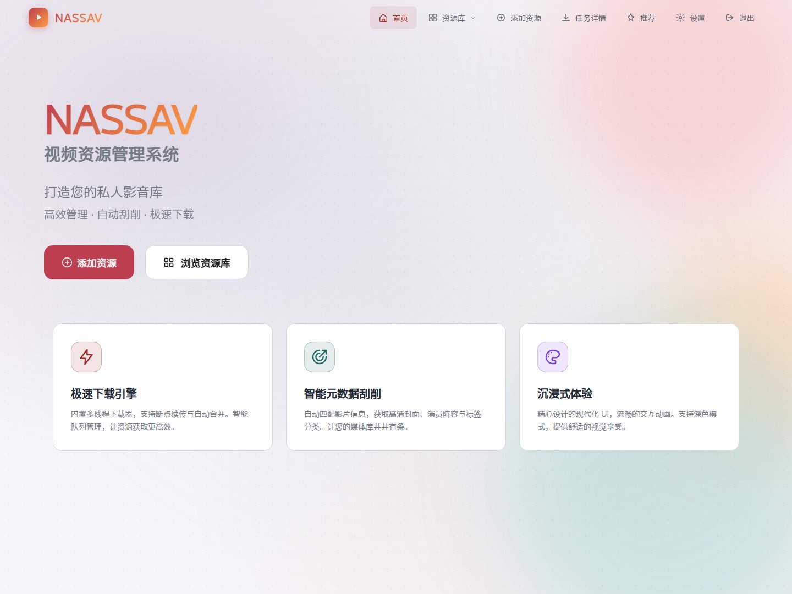

# NASSAV - AV 资源管理系统

当前代码版本：**v2.5.3**（发布准备）。升级步骤与验收边界见[当前升级与切换](django_backend/doc/multi-user-cutover.md)。

基于 Django、Celery 和 Vue 的资源管理系统，将资源收藏与管理、多源发现、个性化推荐和任务控制串成完整流程：搜索感兴趣的资源，补齐元数据，加入资源库，再按需下载。支持实时进度以及任务暂停、恢复和终止。项目基于 [Satoing/NASSAV](https://github.com/Satoing/NASSAV) 重构；历史参考代码已从当前仓库移除。

## 功能与入口

- 资源浏览、搜索、添加、刷新、下载与批量操作；按演员和类别聚合。
- 三个 Celery 队列分别处理默认任务、刮削和下载；持久任务支持单条/批量暂停、恢复、终止与停止后的私有产物清理。
- 推荐通过独立持久任务在 scrape worker 执行，支持进度、取消、反馈、历史避让和黑名单；外部搜索与推荐共用代理服务器并发能力。
- 来源HLS与已下载MP4可在独立标签页播放；个人进度支持继续/从头播放、自动保存与多标签写入保护，播放功能默认关闭。
- 个人中心提供收藏/已观看/备注、稍后再看、去重观看历史、通用/播放设置与显式跨设备接续；个人数据按账号隔离；多用户准入显式开启，默认保留指定操作者登录。
- 统一Django会话、浏览器上下文和CSRF保护HTTP、媒体与任务WebSocket；管理员通过导航栏最右侧进入管理中心。
- [前端页面与本地开发](vue_frontend/README.md) · [后端本地开发](django_backend/README.md) · [后端接口](django_backend/doc/interface.md) · [数据库说明](django_backend/doc/database.md)
- [仓库开发规范](AGENTS.md) · [后端任务架构与职责](django_backend/doc/task-control-architecture.md) · [前端开发契约](vue_frontend/doc/development-contracts.md)

## 界面预览



查看[完整页面介绍与预览](vue_frontend/README.md#功能概览含页面与预览图)：资源库、演员/类别、外部搜索、推荐与黑名单、添加资源、任务详情及设置。预览由当时组件和示例数据生成于2026-10-08，尚未覆盖后续个人中心与播放页。

## 快速开始

默认 Compose 使用 SQLite，包含前端网关、API、Redis、Byparr 和三个 worker。所有后端服务统一使用 `.env` 的 `NASSAV_UID:NASSAV_GID`（默认 1000:1000），首次部署或切换 root 旧实例前按部署说明准备绑定目录权限。首次部署按[全栈 Compose 部署说明](django_backend/doc/compose-deployment.md)准备 `.env`、配置文件和数据目录，然后从仓库根目录运行：

```bash
python3 scripts/compose_stack.py --mode sqlite init
python3 scripts/compose_stack.py --mode sqlite config --quiet
python3 scripts/compose_stack.py --mode sqlite up -d --build
python3 scripts/compose_stack.py --mode sqlite exec api python manage.py createsuperuser --username nassav
```

账号密码由 `createsuperuser` 的交互提示设置。若修改 `NASSAV_OPERATOR_USERNAME`，用户名须与其一致。默认页面仅监听 `127.0.0.1:9780`；远程访问需同源 HTTPS 反向代理，并按部署说明配置 Host、CSRF 和安全 Cookie。Beat 在 `scheduler` profile 中启用且全系统只运行一个实例。

PostgreSQL 模式连接外部数据库，需密码 secret 和 `compose.postgres.yaml` 覆盖文件；具体命令与回滚步骤见[部署说明](django_backend/doc/compose-deployment.md#外部-postgresql可选)。2026-10-08的只读记录曾显示实例使用PostgreSQL并应用至0027；该历史快照不代表当前部署，升级前须核对showmigrations，本轮未检查或修改正式数据库。默认 Compose 仍使用 SQLite；首次启动需声明数据目录的数据库模式，后续 `up`、`ps`、`logs`、`exec`、`down` 使用相同模式的部署入口。直接误用基础 Compose 时，应用会在连接数据库前拒绝模式冲突；不要仅修改 `.env` 的 `DB_ENGINE` 来切换。数据库行为见[数据库模式与备份说明](django_backend/doc/database.md)；开发导入与正式切换的边界见[部署与验证边界](django_backend/doc/compose-deployment.md#近期改动与验证边界)。

本机开发分别参照[后端说明](django_backend/README.md#快速开始)和[前端说明](vue_frontend/README.md#本地开发)；Vite 开发页的 API 和 WebSocket 使用同源代理。启动检查、代理路由和数据目录的细节统一记录在[配置契约](django_backend/doc/configuration-contract.md)、[代理路由](django_backend/doc/proxy-routing.md)和[Compose 部署说明](django_backend/doc/compose-deployment.md)。

## 当前功能与验证状态

资源添加/刷新通过异步任务执行；演员和类别外部搜索支持来源选择、渐进结果、取消和终态补查。下载和批量翻译的 owner/异常收尾修复、资源/下载/翻译/推荐用例分层已实现；消费者 URL、响应字段和 Celery 任务名保持。

v2.5.3在个人状态与设置基础上加入共享资源库、范围加密凭证、版本化读取与回收、个人任务及管理中心，并改善查询/图片缓存、中文时间线和部署预检。普通页面不暴露共享池机制，内部权限、命令版本与取消边界保持。功能详情见[变更日志](CHANGES.md)。

从v2.5.1升级涉及0037–0051，结构迁移与旧资源/个人数据/凭证归属导入分开确认；从更早版本升级先检查已有迁移。完整步骤见[升级与切换](django_backend/doc/multi-user-cutover.md)，本次制品准备和历史目标验收限制见[v2.5.3发布检查](django_backend/doc/release-2.5.3.md)。本轮不执行正式迁移、部署或远端发布。

## 文档导航

- 本地开发：[后端](django_backend/README.md)、[前端](vue_frontend/README.md)
- 个人功能：[个人状态与设置接口](django_backend/doc/interface.md)、[观看列表](django_backend/doc/viewing-architecture.md)、[前端缓存计划](vue_frontend/doc/cache-architecture.md)
- 播放与版本：[版本与读取授权](django_backend/doc/resource-version-architecture.md)、[播放与进度接口](django_backend/doc/interface.md)、[多用户规划](django_backend/doc/resource-pool-architecture.md)、[升级与切换](django_backend/doc/multi-user-cutover.md)
- 消费者与数据：[接口与权限](django_backend/doc/interface.md)、[数据库与备份](django_backend/doc/database.md)、[推荐系统](django_backend/doc/recommendation.md)
- 架构与配置：[持久任务控制与资产提交](django_backend/doc/task-control-architecture.md)、[推荐架构](django_backend/doc/recommendation-architecture.md)、[代理并发](django_backend/doc/proxy-concurrency.md)、[持久抓取缓存](django_backend/doc/resource-cache-architecture.md)、[配置契约](django_backend/doc/configuration-contract.md)、[代理路由](django_backend/doc/proxy-routing.md)
- 运行与复验：[Compose 部署](django_backend/doc/compose-deployment.md)、[进程管理](django_backend/doc/host-processes.md)、[脚本](django_backend/scripts/README.md)、[测试](django_backend/tests/README.md)、[部署与验证边界](django_backend/doc/compose-deployment.md#近期改动与验证边界)

## 持续开发

- 多用户与资产：[角色及配额](django_backend/doc/account-policy-architecture.md)、[准入与浏览器上下文](django_backend/doc/multi-user-admission-architecture.md)、[范围凭证](django_backend/doc/source-credential-architecture.md)、[共享工作](django_backend/doc/shared-work-architecture.md)、[资源版本](django_backend/doc/resource-version-architecture.md)、[回收账本](django_backend/doc/resource-gc-architecture.md)。
- 播放及个人数据：[播放会话](django_backend/doc/online-playback-architecture.md)、[个人进度](django_backend/doc/playback-progress-architecture.md)、[个人状态与JSON设置](django_backend/doc/personal-state-architecture.md)、[观看列表](django_backend/doc/viewing-architecture.md)。
- 前端与图片：[缓存架构](vue_frontend/doc/cache-architecture.md)、[本人结果图片](django_backend/doc/discovery-image-architecture.md)。临时方案与现场执行报告从Git历史追溯，开发以现行契约和代码为准。

## 版本更新

完整历史与后续变更日志统一维护在 [CHANGES.md](CHANGES.md)。

## 许可证

本项目基于原仓库 [Satoing/NASSAV](https://github.com/Satoing/NASSAV) 重构开发，遵循相同的许可证。

## 致谢

感谢 [Satoing/NASSAV](https://github.com/Satoing/NASSAV) 原项目的启发和基础代码。
