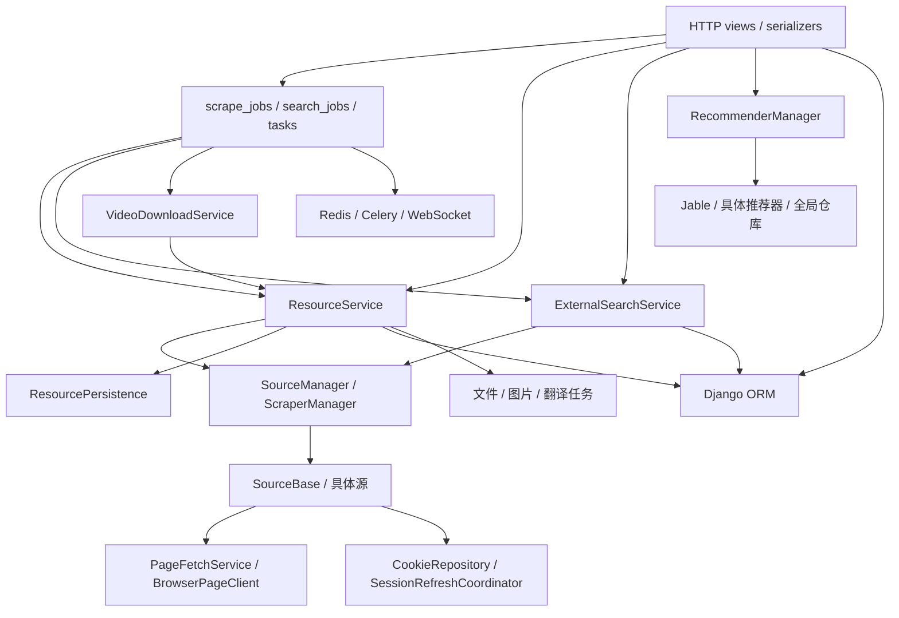

# 后端模块抽象与设计原则评估报告

评估日期：2026-10-04。代码基线：`dev@106a719`（`[Feat] Add manual external search and task cancellation`）。配套文档：[重构执行计划](backend-refactoring-plan.md)。

## 1. 结论

后端已经具备分层和可替换实现的基础，但抽象程度不均衡：页面获取、下载器、推荐评分因子、删除与持久化接口比较清晰；源管理、资源流程、外部搜索、推荐装配、Celery 任务和部分 HTTP 视图仍依赖具体实现或承担多种变化职责。整体判断为“部分遵循面向接口编程、单一职责和开闭原则”，不能根据已有 `Base`、`Manager`、`Service` 命名认定全面符合。

最值得优先处理的是：让已有接口成为调用方真正使用的契约，将源特有行为收敛到对应 Adapter，将基础设施装配从业务流程移出，并收敛错误、进度和状态更新契约。仅增加 ABC 或把大文件拆成小文件，不能解决这些问题。

本报告中的高优先级表示重构收益和变更传播风险较高，不表示已发现线上故障。并发、重试和一致性方面的风险均需专门测试确认。

## 2. 范围、方法与判断口径

静态扫描覆盖 `nassav/` 下除 migrations 外的 87 个 Python 文件，共 20,685 个物理行；同时检查 `django_project/` 配置与运行入口、管理命令、现有文档和相关测试。重点追踪资源新增/刷新/删除、下载、翻译、外部搜索、推荐六条链路。行数只用于定位复杂度集中处，不作为抽象质量分数。

核心流程与接口逐段检查；配置、管理命令和辅助模块按职责及关键调用点检查。没有逐项执行全部运维脚本，也没有进行真实外站、Redis、PostgreSQL 或部署验收。因此这是一份代码结构评估，不是运行正确性证明或性能测量报告。

判断依据是当前代码、[后端规范](../AGENT.md)、[P5 业务边界](p5-domain-boundaries.md)、[接口说明](interface.md)、[推荐说明](recommendation.md)和[测试说明](../tests/README.md)。下文定位采用“相对文件路径 + 基线行号 + 符号”；重构后以符号为准。

| 维度                       | 本次判断标准                                                                                   |
| -------------------------- | ---------------------------------------------------------------------------------------------- |
| 面向接口 / 依赖倒置（DIP） | 调用方依赖稳定行为契约，具体实现能在装配处替换，业务过程不自行构造或查找具体实现               |
| 单一职责（SRP）            | 模块围绕一个主要变化原因组织；业务规则、网络协议、状态存储、文件路径、传输展示不被无必要地捆绑 |
| 开闭原则（OCP）            | 新增同类源、策略或存储实现时，主要新增 Adapter 与装配声明，不修改多个公共流程分支              |
| 接口隔离（ISP）            | 消费者只需要自身用到的能力；详情、列表、会话和图片能力可分别表达                               |
| 里氏替换（LSP）            | 替换实现保持返回类型、失败语义、副作用和调用约束；不靠类型判断或捕获签名错误适配               |
| Module Depth               | 小而稳定的 Interface 隐藏真实复杂性，调用方不必了解内部容器、私有方法、执行顺序和错误状态字段  |

SOLID 属于设计原则；模板方法、策略、工厂、Adapter、Repository、观察者是本项目中可识别的实现模式。两者分别评估。评级为“较好 / 部分 / 较弱”，是定性判断，不做缺乏依据的综合百分比。

## 3. 当前依赖结构

已有分层是真实存在的；主要耦合也发生在这些层之间。图表示代码依赖和运行调用关系，不宣称存在 Python 导入环；延迟导入虽能缓解导入问题，仍保留业务依赖。

## 4. 各模块评估总览

| 模块范围                                                                                        | 接口 / DIP | SRP  | OCP  | 抽象程度与主要依据                                                                 |
| ----------------------------------------------------------------------------------------------- | ---------- | ---- | ---- | ---------------------------------------------------------------------------------- |
| `page_fetching/contracts.py`、`browser.py`、`service.py`、`factory.py`                          | 较好       | 较好 | 较好 | ABC + `PageResult` + 两种浏览器实现；策略、验证、装配已分离，工厂变更合理          |
| `page_fetching/coordination.py`、`session.py`                                                   | 部分       | 较好 | 部分 | 协调与候选筛选独立；协调器注入类型仍是具体 Redis 存储                              |
| `source/SourceBase.py`、`Jable.py`、`MissAV.py`、`Memo.py`                                      | 部分       | 较弱 | 部分 | 详情接口可复用，但公共基类还负责 HTTP、Cookie、DB、探测与锁协调                    |
| `source/SourceManager.py`                                                                       | 较弱       | 较弱 | 较弱 | 源注册、具体构造分支、权重、会话、缓存、回退、路径集中                             |
| `source/CookieRepository.py`、`CookieRuntimeCache.py`                                           | 部分       | 部分 | 部分 | 会话快照、CAS、缓存已有集中封装；消费者直接使用全局具体仓库                        |
| `source/MissAVListings.py`、`jable_actor_mapping.py`、`search_contracts.py`                     | 部分       | 较好 | 部分 | 站点解析/异常职责独立；Jable 映射含 ORM 同步，宜保持站点局部性                     |
| `scraper/`                                                                                      | 部分       | 部分 | 部分 | 获取/解析模板和多实现存在；协议未被使用，元数据为裸 dict，图片能力混合             |
| `translator/`                                                                                   | 部分       | 部分 | 部分 | ABC 与重试模板有效；具体装配、启动可用性检查、配置与词汇处理耦合                   |
| `m3u8downloader/`                                                                               | 较好       | 较好 | 较好 | 下载器由构造函数注入，子进程与进度解析在具体 Adapter 内；协议未覆盖输出规范化      |
| `services.py`                                                                                   | 部分       | 较弱 | 部分 | 下载器可替换；下载业务隐式引用全局资源服务，文件内又包含资源查询                   |
| `resource_service.py`                                                                           | 部分       | 较弱 | 部分 | 对外 add/refresh 有较高 Depth，但 ORM、文件、头像、序列化和任务提交仍在内部硬耦合  |
| `resource_persistence.py`、`download_persistence.py`                                            | 较好       | 部分 | 部分 | 小 ABC + Django Adapter；资源持久化还接收源实例/HTML并处理 Jable 规则              |
| `resource_deletion.py`                                                                          | 较好       | 较好 | 部分 | 文件锁、顺序删除、部分失败集中在单一操作；仓库返回 ORM 类型，迁移成本仍存在        |
| `external_search.py`                                                                            | 部分       | 较弱 | 较弱 | Adapter/缓存 ABC 已有；能力、排序、源定位和站点分支留在公共流程                    |
| `scrape_jobs.py`、`search_jobs.py`                                                              | 部分       | 部分 | 部分 | `JobStore` 与 Redis实现可替换；入队、状态规则、发布、业务执行仍组合于同模块        |
| `tasks.py`                                                                                      | 较弱       | 较弱 | 较弱 | 下载、模拟、翻译、队列、锁、进度、运维包装集中；大量全局基础设施调用               |
| `recommendation/base.py`、`factors.py`、`strategies.py`、`entities.py`                          | 部分       | 部分 | 较好 | 因子/策略可组合，数据对象明确；基类直接查 ORM、全局 profile 仓库，子类复制总流程   |
| `recommendation/manager.py`、`jable_search.py`、`jable_page_lookup.py`                          | 较弱       | 部分 | 部分 | 推荐器仍通过 ID 分支构造，直接创建 Jable；查找/召回和总体编排耦合                  |
| `recommendation/seeds.py`、`seed_profiles.py`、`feedback.py`                                    | 部分       | 部分 | 部分 | `SeedProvider` 与学习数据职责已分开；种子选择依赖 ORM，学习规则依赖全局仓库        |
| `recommendation/repository.py`、映射、屏蔽、封面、懒映射模块                                    | 部分       | 部分 | 部分 | 快照与屏蔽集中封装；封面已有 MissAV/Jable分支，仓库多为具体全局实现                |
| `views.py`、`search_job_views.py`、`auth_views.py`、`urls.py`、`api_utils.py`、`serializers.py` | 部分       | 较弱 | 部分 | 搜索任务/认证视图较薄；主视图聚合业务域，包含查询、文件、图片和状态修改            |
| `consumers.py`、`routing.py`、`access.py`、`ws_origin.py`                                       | 较好       | 较好 | 部分 | 通道、权限、同源握手职责清楚，依赖框架本身合理；业务发布端可收敛                   |
| `signals.py`、`receivers.py`、`apps.py`                                                         | 部分       | 较好 | 部分 | 观察者模式降低发布端直接依赖；事件 payload 和调用时机仍需契约化                    |
| `legacy_batch.py`                                                                               | 部分       | 部分 | 部分 | 操作类隔离旧兼容流程；直接 ORM/全局资源服务及翻译任务依赖仍存在                    |
| `models.py`、migrations                                                                         | 部分       | 较好 | 部分 | 属于 Django 数据 Adapter；多模型集中并不自动违反 SRP，模型约束与 DB 演进应保留     |
| `user_settings.py`                                                                              | 部分       | 部分 | 部分 | 路径可注入且缓存按路径隔离；配置读写、类型转换、默认值、热加载同处，当前规模可接受 |
| `utils.py`、`constants.py`、`logging_setup.py`、兼容客户端                                      | 部分       | 部分 | 部分 | 缩略图、HTTP 日期、限流、头像等工具混合；优先整理重复资源处理，不必逐函数加接口    |
| `django_project/`、`management/commands/`                                                       | 部分       | 部分 | 部分 | 配置校验、DB模式保护、入口已有独立模块；备份命令内有引擎分支，当前两引擎支持可接受 |

表中范围覆盖全部生产模块类别；同一行内的细分模块可能优劣不同，下面用具体事实展开。空 `__init__`、声明型文件、迁移历史不作为独立业务模块打分。

## 5. 需要保留的有效设计

### 5.1 页面获取是当前较好的深 Module

[`BrowserPageClient`](../nassav/page_fetching/contracts.py)（48）只暴露 `fetch`；`PageResult`（26）统一内容、状态和失败类别。`PageFetchService.fetch`（`service.py:46`）隐藏路径选择、回退、挑战页和错域检查。调用方通过 validator 提供业务页判断，不需要了解 Byparr / FlareSolverr 响应结构。

`factory.py:91` 负责具体实现选择。新增 provider 时修改工厂是装配变化，不等同于违反 OCP。`test_page_fetching.py` 和 `test_browser_page_client.py` 已通过 Fake/模拟响应覆盖这个 Interface，应保留此 Seam。

### 5.2 持久化、删除和下载已有真实的替换位置

`ResourcePersistence.save`（`resource_persistence.py:23`）、`DownloadPersistence.mark_completed/mark_failed`（`download_persistence.py:15/19`）、`ResourceDeletionRepository`（`resource_deletion.py:40`）都能承载 Django Adapter 与测试替身。

`ResourceDeletionService` 将锁、文件选择、顺序和已完成部分收敛在 `delete_resource/delete_video`，其职责是一个完整删除操作。不能因为“同时碰文件和数据库”就直接判定违反 SRP。`test_resource_deletion.py` 已覆盖统一入口、失败与重试，是值得保留的行为契约。

`VideoDownloadService.__init__`（`services.py:23`）注入 `M3u8DownloaderBase`；`N_m3u8DL_RE.py` 隐藏 CLI 参数和进度解析。现有缺口是元数据解析与输出确认的 Interface，不必重新发明下载器架构。

### 5.3 推荐因子和策略是真正可组合的扩展点

`RecommendationFactor.score`（`factors.py:9`）有多个实现；`AbstractRecommender.score_candidates`（`base.py:341`）只调用统一评分方法。`RecommendationStrategy`（`strategies.py:23`）组合种子提供者、因子 builders 和参数。新增评分因子主要通过新增实现和装配完成，OCP 遵循程度较好。

`SeedProvider`（`seeds.py:19`）提供统一种子入口；`entities.py` 中请求、候选、执行数据对象比跨层裸 dict 更明确。保留这些成果，重构重点是数据读取和总体流程，而非替换评分体系。

## 6. 主要问题与代码证据

### F01：早期协议与调用方脱节，存在双份契约漂移

- **证据**：`ISource`（`source/SourceBase.py:27`）、`IScraper`（`scraper/ScraperBase.py:12`）、`ITranslator`（`translator/TranslatorBase.py:11`）、`IM3u8Downloader`（`m3u8downloader/M3u8DownloaderBase.py:10`），全后端 Python 检索仅命中各自声明。
- **实际调用**：Manager 容器依赖 Base；翻译 Manager 调用 `translate_with_retry`，但 `ITranslator` 未声明；下载流程调用 `ensure_mp4`，但 `IM3u8Downloader` 未声明；`IScraper` 缺少 Manager 使用的 `scrape/download_cover`。`ISource.get_cover_url` 声明 `str`，MissAV/Memo 实现返回 `Optional[str]`。
- **判断**：Base 本身仍是接口的一种，不能说项目完全没面向接口编程；问题是额外声明的 Protocol 未成为契约且与实际能力不一致。
- **规范偏差**：`SourceBase`、`ScraperBase` 没有继承 ABC，必需方法只运行时抛出 `NotImplementedError`；不满足后端规范要求的可强制抽象基类。可选 `search_listing` 应保留显式“不支持”语义，不能为满足规范强迫所有源提供虚假实现。

### F02：源基类和源管理器吸收了过多基础设施与装配责任

- **证据**：`SourceBase.set_cookie_auto`（127）、`accept_browser_session`（342）、`coordinate_browser_fallback`（426）直接使用 `source_cookie_repository`、`session_refresh_coordinator`，同时处理 provider 名、路由、探测和 CAS。`SourceManager.__init__`（51）按 MissAV/Jable 名称进行不同构造；`auto_source_cookie`（135）也做租约和等待。
- **Interface 泄漏**：管理器调用源 `_get_home_url`（141），`views.SourceCookieView` 调用 Manager `_get_source`（279）；多个模块遍历 `source_manager.sources`，了解内部实例及其配置。
- **影响**：改会话存储、协调策略或新增构造方式，会同时影响公共基类、Manager和调用方。删掉 Manager 后这些复杂性会散落，因此它有价值；应缩小 Interface 并收敛内部 Seam，不能只删除一层。

### F03：资源服务的依赖注入不完整，持久化接口携带抓取细节

- **证据**：`ResourceService.__init__`（136）接受三个具体 Manager 与持久化接口，但 `add_resource`（205）仍直接查询 ORM；`_save_all_resources`（391）写 HTML、编排图片/头像和序列化；`_submit_translate_task`（616）延迟导入 Celery任务并 `.delay()`。
- **持久化混合职责**：`ResourcePersistence.save` 接收 `SourceBase`、HTML，返回 `AVResource`。`DjangoResourcePersistence._extract_source_actor_names`（133）、`_sync_source_actor_mappings`（185）解析 Jable HTML并处理站点条件，`save` 还修改传入 `info` 对象。
- **判断**：资源编排可以保留为一个深 Module；需要把网络资产、调度和来源元数据转化为可替换内部依赖，先将已解析数据交给持久化。ORM 返回类型可以分阶段保留，没必要立即切成全新的领域模型。

### F04：外部搜索存在 Adapter，但公共流程仍识别具体源

- **证据**：`ExternalSearchService.__init__`（452）自行创建 Adapter；`capabilities`（459）硬编码标签和排序；`_search_items`（582）对 MissAV 校验、进度排序、最终排序做专用分支。`cover_cache.ensure_cached/is_allowed_url`（25/53）也根据源名处理不同图片策略。
- **契约不稳定**：Jable Adapter 的 `_call_get_model_videos`（233）判断 `isinstance(SourceBase)` 并捕获 `TypeError` 重试旧签名；其他查询也有类似桥接。若实现内部抛 `TypeError`，可能被误判为签名不兼容并重复调用，这是需测试的风险。
- **影响**：新增支持列表搜索的源要修改 Adapter 注册、能力列表、参数校验、排序、序列化来源选项等多处。固定的 HTTP source choices（`search_job_views.py:28`）是另一同步点。
- **改进方向**：将能力、排序语义和缓存上下文随 Adapter 一起注册；通用流程只消费能力和结果。图片下载保留独立受控策略，不能为了统一接口而把 Cookie 传给第三方 CDN。

### F05：下载/翻译任务层职责集中，状态契约不够独立

- **证据**：`tasks.py` 1,269 行，`download_video_task`（486）负责 AVID锁、全局锁、队列、进度节流、通知、下载、持久化、重试和清理；`translate_title_task`（735）包含标题选择、跳过规则、ORM状态更新和翻译调用；同文件还包含模拟任务与运维包装。
- **隐式依赖**：`VideoDownloadService.download_video`（`services.py:36`）内部导入全局 `resource_service` 并触发资源新增，注入的 SourceManager并非全部依赖。
- **一致性风险**：下载成功通知先于 `mark_completed`；持久化异常被记录后仍返回成功。这里是现存语义，不能在“纯重构”中悄悄改变，应先记录并隔离，再单独决策。
- **判断**：小 Celery入口、下载用例和基础设施 Adapter 比一个通用任务框架更合适。重试属于 Celery适配职责，业务步骤和终态不应靠分散通知隐式定义。

### F06：推荐基类和装配层仍依赖 ORM、全局仓库及具体源

- **证据**：`AbstractRecommender.exclude_existing_resources`（`base.py:91`）直接查询 `AVResource`；屏蔽过滤从函数内导入全局 profile仓库；`RecommenderManager.build_recommender`（210）按 ID 分支，`_build_jable_page_lookup_recommender`（227）直接 `Jable(proxy=proxy)`。
- **模板漂移**：`JableSearchRecommender.recommend`（`jable_search.py:30`）重写基类完整管线，增加扩种、详情补量等步骤，多个过滤顺序需分别维护。合理的特殊业务流程确实存在，但应通过明确 hook/阶段契约表达。
- **影响**：纯算法测试仍需 ORM或全局替换；新增推荐器要同步元信息与构造分支。既有策略和因子仍是有效扩展点，这不否定整个推荐体系。

### F07：部分 HTTP 视图越过应用 Interface，公共入口过于集中

- **证据**：`views.py` 2,401 行，包含资源、演员、类别、推荐、Cookie、下载及任务入口。`ResourceCoverView`（1177）处理路径、ETag、缩略图生成与文件返回；`RefreshResourceView`（1712）直接读写 ORM并补提交任务。`search_job_views.py` 又从 `views.py` 导入 `SchemaAPIView`。
- **判断**：简单只读 ORM查询留在 Django视图不必一律抽 Repository；图片处理、翻译状态和复杂更新流程则应收敛为独立用例。拆 `views.py` 有助于导航，但必须伴随职责迁移。
- **规范偏差**：私有方法被外部调用；源容器暴露让调用方绕开 Manager 的 Interface。处理这些真实耦合比逐个视图加 ABC 更有效。

### F08：错误和数据契约从底层到上层逐步丢失

- **证据**：`PageResult.failure` 是显式枚举；Source层又通过 `last_error_code` 旁路传递失败，Manager声明 `Dict[str, int | None]`，实际上还可能保存异常类型字符串。Scraper / Translator多返回 `None`；`AVDownloadInfo`（`scraper/AVDownloadInfo.py:10`）同时承担数据、字典合并和文件写入。
- **另一个例子**：`MissAV.parse_html`（180）会调用 `_get_highest_quality_m3u8`（239）进行 HTTP请求；名字为解析的方法并非纯解析，其网络与代理约束对调用方不明显。
- **影响**：空结果、网络失败、不支持能力与业务不存在不易统一区分；测试需要知晓旁路状态和隐式副作用。应逐条链路引入有类型的结果与错误映射，避免一次改变所有对外响应。

## 7. 设计模式遵循情况

| 原则 / 模式          | 判断               | 说明                                                                                         |
| -------------------- | ------------------ | -------------------------------------------------------------------------------------------- |
| 面向接口编程 / DIP   | 部分遵循           | 下载器、持久化、页面客户端、因子有真实契约；业务入口仍依赖具体 Manager、全局实例和 ORM       |
| SRP                  | 部分遵循           | 网络 provider、删除和权限模块较集中；源基类、主视图、任务和搜索模块变化原因较多              |
| OCP                  | 部分遵循           | 增加评分因子比较局部；新增来源会传播到构造、能力、排序、参数和封面策略                       |
| ISP                  | 较弱至部分         | 详情源、列表搜索、会话和图片能力混在 Base；协议又缺少实际调用能力                            |
| LSP                  | 部分，缺少完整证明 | 已有 Fake支持部分替换；类型和失败语义不一致、按实现类型分派和签名兜底需修正                  |
| 模板方法             | 已使用，部分漂移   | Scraper、Translator、推荐基类有模板；Source/Scraper缺 ABC强制约束，推荐子类复制主流程        |
| 策略                 | 已有效使用         | 推荐因子、种子、策略 builders；页面抓取策略的固定分支目前规模可接受                          |
| 工厂 / 注册表        | 已使用，装配未集中 | 映射表不必动态化；业务流程中实例构造及站点分支才是重点                                       |
| Adapter / Repository | 已使用，部分泄漏   | 页面客户端与 Redis JobStore较明确；资源 Repository接收 HTML/源实例，返回 ORM                 |
| 观察者               | 已使用             | Django signals/receivers与 WebSocket发布解耦部分调用，但 payload和时机仍是 Interface的一部分 |
| 单例 / 全局实例      | 广泛使用，需约束   | 配置稳定时可简化调用；业务测试和导入副作用增加，宜通过统一装配入口提供默认实例               |

## 8. 重构优先级及不应做的事

| 优先级 | 问题                             | 建议                                                                         |
| ------ | -------------------------------- | ---------------------------------------------------------------------------- |
| 高     | F01、F02、F04                    | 收敛已存在的能力接口与源装配，移除公共搜索中的站点分支；先保护会话与搜索行为 |
| 高     | F03、F05                         | 把资源/下载用例依赖补齐，收敛结果和状态契约；先保持现有失败/成功语义         |
| 中     | F06、F07                         | 推荐算法读取接口、推荐器工厂和视图职责迁移；依据已冻结的行为推进             |
| 中     | F08                              | 配合各链路引入类型化结果，不做全仓库同时替换                                 |
| 低     | 辅助工具、管理命令、模型文件布局 | 按真实复用和变化压力整理；当前引擎分支和声明文件无需架构翻新                 |

不建议把所有函数套上 ABC、引入通用 CRUD Repository、建设动态插件系统，或把调用关系相同的大文件机械拆分。也不建议把 ORM字段全部复制成领域对象后再继续原样查询。每个新增 Seam都应有真实变化需求及至少生产 Adapter + 行为测试替身；没有收益的转发层应合并或删除。

现有配置/数据库模式保护、权限、URL、Celery任务名、Cookie+UA+出口会话单元、CAS/租约规则、搜索失败可见性以及删除部分失败语义，都应作为执行计划的约束，而非顺便调整的实现细节。

## 9. 验证边界

本次交付只新增本报告和配套计划，未实施业务重构。静态结论与上述基线代码相对应；已有测试被阅读用于判断可测试性，不能将“测试存在”解释为“本次全部通过”。实际执行的离线测试及 `pre-commit run -a` 结果记录在[计划验证记录](backend-refactoring-plan.md#9-本次文档交付验证记录)。
