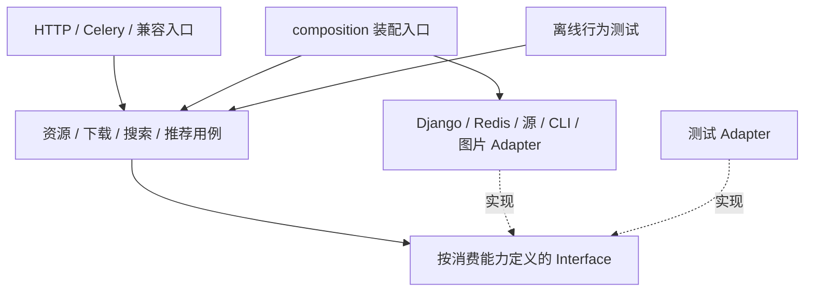

# 后端抽象重构执行计划

计划日期：2026-10-04。分析基线：`dev@106a719`。依据：[模块抽象评估报告](backend-abstraction-report.md)。执行状态与实测结果见[执行记录](backend-refactoring-execution.md)。

当前执行到 R3，相关分支已通过质量门槛并合并 `idle`。R4 下载的锁丢失验收复现既有 owner 缺陷，草稿保存且未合并，后续执行等待用户决定独立语义修复范围，详见[R4 阻塞记录](backend-refactoring-r4-blocker.md)。原验收门槛保持。

## 1. 目标与范围

让已有接口承载真实调用契约，将来源变化限制在来源 Adapter和装配处，将资源、下载、翻译、搜索、推荐用例与 HTTP / Celery / ORM / Redis实现逐步解耦。保留有效的页面获取、删除、评分和持久化设计，避免建立与现有架构平行的新体系。

验收结果应表现为：新增来源不修改通用搜索/排序流程；测试能通过构造函数替换用例依赖；修改网络 provider、队列存储或图片策略只影响对应 Adapter及装配；外部调用方不再遍历内部源容器或调用私有方法。

本计划不包含数据库迁移、生产切换、外站抓取策略优化或前端功能改版。若执行中需要这些行为变化，单独提出具体变更、证据与验收方案。

## 2. 执行纪律与兼容基线

使用隔离工作树 `/tmp/nassav-agent-worktree` 和独立功能分支；默认工作树保持 `dev`。用户已授权每功能/阶段质量门槛通过后自动提交并合并到 `idle`，最终工作树回到 `idle`；提交遵循 `[Enhancement]` / `[Fix]` / `[Doc]` 等前缀。质量门槛无法达成时停止并与用户沟通决策。

冻结的对外与运行契约：

- URL、响应 envelope、状态码、字段及分页/排序含义；旧同步资源入口与异步入口继续共存。
- Celery任务名、路由队列、参数、重试语义，Redis key、TTL、锁所有权及旧任务兼容性。
- 搜索 token校验、版本递增、终态不可覆盖、取消与进度竞争、过期查询和故障可见性。
- Cookie、UA、有效期、出口配置组成完整会话；CAS、人工写入优先、有限等待、失租不能写入、挑战页/错域拒绝规则。
- 文件路径、下载代理隔离、图片来源限制、第三方 CDN不转发站点 Cookie、删除锁及部分失败报告。
- 数据库 schema、metadata格式、关联规则、备份/恢复、配置默认值与 Compose DB模式保护。
- 认证、CSRF、单一操作者权限、WebSocket同源检查及原有事件字段。

现有“下载成功通知后，DB持久化失败只告警仍返回成功”等行为必须先做特征测试并记录。改善这些行为应单独列为语义修复，不与结构迁移混合。对已知不合理行为的冻结只是为了可对照重构，并非认可它作为长期设计。

## 3. 目标结构与接口选择



`composition.py` 可作为默认装配入口，构造配置和依赖后提供稳定实例；不建设动态插件加载框架。用例不从函数体内导入这个入口，入口的 Adapter可在外部入口处注入。

以下名称为设计候选，需在对应阶段完成调用点核对后确定，不能当作已经实现的模块：

| Interface 候选        | 消费者需要的能力                          | 生产 Adapter / 现有基础              | 返回与副作用约束                               |
| --------------------- | ----------------------------------------- | ------------------------------------ | ---------------------------------------------- |
| 详情源查询            | 指定源/回退源获取下载信息                 | `SourceManager`、现有 Source         | 返回信息、来源上下文和错误，避免暴露源实例容器 |
| 列表搜索能力          | 能力描述、分页获取、排序语义、缓存上下文  | 现有 `ExternalSourceAdapter`         | 空结果和失败分离；站点特例在 Adapter内         |
| 会话读写              | 获取完整快照、条件写入、手工更新          | `SourceCookieRepository`             | CAS/人工覆盖、失租行为不变                     |
| 会话刷新存储          | owner检查、续租、释放、结果、短期抑制     | `RedisRefreshStore`                  | 与现有 Fake共享相同契约，不扩展成通用锁平台    |
| 资源读写              | 存在性、读取、保存已解析元数据            | 已有 `ResourcePersistence` + ORM读取 | 过渡期允许 ORM返回值；目标不接收 HTML/源实现   |
| 资产处理              | 保存页面、封面、头像等资产结果            | 现有文件/图片实现                    | 路径、失败与来源限制明确；内部可继续组合小模块 |
| 任务提交 / 事件发布   | 提交翻译任务、发布进度/业务事件           | Celery、signals、Channels            | 成功/失败返回明确；由上层确定提交和发布时机    |
| 下载信息解析          | 缓存读取与必要的资源准备                  | `ResourceService`现有能力            | 隐藏获取过程，明确会触发哪些副作用             |
| 下载执行 / 输出确认   | 下载、进度、确认 MP4                      | `M3u8DownloaderBase`、CLI Adapter    | 不把扩展名重命名表述为转码；兼容已有行为       |
| 推荐历史 / 资源存在性 | 批量查询已存在资源、历史、屏蔽/学习上下文 | 现有推荐仓库                         | 算法消费数据，避免每个候选一次 ORM查询         |

后端规范要求业务模块拥有抽象基类：新增可替换业务能力以小 ABC为主，保留确实有用的模板方法。若 Protocol继续存在，应满足结构类型检查并与消费者一致；不能长期维护两份漂移的契约。纯函数、数据类和 Django框架入口不因本计划额外建立业务继承层。

## 4. 阶段安排与任务清单

依赖顺序：`R0 → R1 → R2 → R3 → R4`；`R5` 在 R1/R2之后可独立安排；`R6` 在相关用例稳定后推进；`R7` 做最终收敛。预计总计 18–31 个工程人日，含行为测试与评审，不含目标环境验收、生产发布或额外语义修复。估算用于排序，须在 R0后调整。

### R0：冻结行为与建立验证基线（1–2 人日）

**关联**：全部问题，尤其 F05/F08。

1. 列出六条链路的入口、任务名、配置、缓存 key、状态字段、写入/事件时序。复核 [会话兼容基线](backend-refactoring-execution.md)，补充搜索取消与来源能力语义。
2. 使用临时 SQLite、文件目录、模拟网络/队列确认可复现的离线基线；将遗留实时测试、依赖缺失、已知失败与本次重构失败区分。
3. 补关键行为特征测试：下载通知/持久化异常顺序、资源写入部分失败、搜索合法空结果与失败、重复执行和取消竞争。只补缺口，不复制已有测试。
4. 建立每个新增 Interface的契约清单：输入、返回、异常、幂等性、线程/进程状态、可观测字段和调用次数。

**交付**：行为矩阵、离线命令、基线结果和兼容清单。

**验收**：执行者能复现基线；不访问真实 Cookie/外站/生产DB；既有缺陷有单独记录，后续可判断是否新增回归。

**回退**：撤回新增测试/记录即可，无业务路径切换。建议提交：`[Chore] Establish backend refactoring behavior baseline`。

### R1：收敛能力契约和装配入口（2–3 人日）

**关联**：F01/F02/F04。**改动范围**：各 Base/Manager、公共注册与装配；先不改变网络和状态流程。

1. 将 Source / Scraper必需方法变为 ABC约束；可选列表能力独立声明。不支持列表的 Memo继续显式拒绝。
2. 核对四个 `I*` 协议：删除无消费者的重复协议，或让消费者真正使用完整能力契约；下载输出规范化、翻译重试选择一个明确责任归属。
3. 修正返回类型和错误类型，如 cover URL可为空、源错误可含分类字符串；通过兼容层保持对外 payload。
4. 给 Manager增加 public查询/能力方法，逐点替换 `_get_source`、`_get_home_url`和外部 `.sources`遍历；迁移期可保留内部容器。
5. 源/刮削/翻译注册接受 factories或已构建实例；生产默认依赖在装配处生成，Manager不再包含 Jable/MissAV专用构造分支。
6. 消除翻译 Manager构造时主动联网的必要性，明确 lazy可用性检查语义；若行为有变化，先加特征测试和独立记录。

**验收**：缺少必需方法的实现不能实例化；一个最小测试 Adapter能通过 Manager；已知生产实现通过共享契约测试；新增测试源只修改装配与实现，不修改 Manager流程。`rg`确认目标调用方没有私有调用。

**回退**：入口保留原 Manager默认实例导出，回退为旧装配即可；尚不变更缓存/任务持久格式。建议提交：`[Enhancement] Align backend capability contracts and composition`。

### R2：会话职责内聚与搜索来源扩展（3–5 人日）

**关联**：F02/F04/F08。分两个可独立回退的提交，先会话，再搜索。

1. 以 `CookieRepository`和 `RedisRefreshStore`的实际方法建立注入 Seam，将会话提交/协调从 `SourceBase`移到内部会话模块；保留 `BrowserSessionHandler`及 Source兼容委托。
2. 保持完整快照、CAS、3秒探测预算、路由键、有限等待和租约校验。不要把刷新 single-flight变成跨请求复用业务页面结果。
3. 扩充 `ExternalSourceAdapter`的 capability描述，包含 source ID、显示名、支持实体、orderings、源排序/客户端排序语义、缓存上下文。
4. 将 MissAV专用排序和能力判断移到对应 Adapter，HTTP source校验从同一已启用能力集生成；通用流程只组合分页、去重、缓存和进度。
5. 将 Jable旧签名桥接隔离到显式 legacy Adapter，移除捕获任意 `TypeError`作为兼容机制；先核对真实调用方和测试替身。
6. 封面下载使用来源策略；保留 MissAV限大小、原子替换、响应类型检查和第三方Cookie隔离规则。

**验收**：新增一个测试列表源无需改通用排序或能力流程；空结果/失败/不支持可区分；多来源缓存不能串用；会话测试覆盖人工写入、Redis故障、失租、不同站点并发与同站等待。

**回退**：保留旧 Source方法委托；搜索入口按装配切回旧 Adapter流程。兼容现有缓存 v4键；若结果结构需要变化，用新版本前缀，不清空共享缓存。建议提交：`[Enhancement] Isolate source session lifecycle`、`[Enhancement] Localize external search source policies`。

### R3：资源用例完整注入与数据持久化纯化（3–5 人日）

**关联**：F03/F08。**范围**：资源服务、持久化、资产、兼容批量；保留删除 Module。

1. 将 add/refresh的资源读取依赖也注入，避免只抽写入接口而读取仍直接 ORM。
2. 将 HTML保存、封面/头像处理、翻译提交与事件发布放入可替换内部依赖；`ResourceService`仍对外提供完整资源操作。
3. 来源 Adapter输出解析后的演员/类别映射信息；持久化不再接收源实例和 HTML，不再识别 `source_name == jable`。
4. 定义类型化保存输入和资产结果，集中 metadata转换；避免持久化修改传入的下载信息对象。过渡 Adapter负责旧 dict/ORM返回值兼容。
5. 将资源序列化集中到展示模块；HTTP、旧批量和任务终态消费一致输出。
6. 检查 DB事务与非事务文件操作的已有顺序；保留部分成功/失败规则。需要补偿机制或改变事件时机时单独立项。

**验收**：用替身完成新增/刷新全流程，无真实网络/Redis；Django Adapter独立通过关系与 metadata测试；来源解析测试不触发 ORM；失败后的资产结果和事件行为与 R0一致；重复调用行为有明确测试。

**回退**：入口切回兼容 ResourceService，保存字段和格式不变；不删除旧 wrapper直到调用点与测试迁完。建议提交：`[Enhancement] Isolate resource workflow dependencies`。

### R4：下载和翻译任务变为传输 Adapter（3–5 人日）

**关联**：F05/F08。**范围**：`tasks.py`、`services.py`、下载持久化、翻译调度。

1. 建立下载信息解析依赖，移除 `VideoDownloadService`方法体内的全局 ResourceService导入；缓存未命中时的资源准备副作用写入契约。
2. 分离下载用例与队列/锁/进度存储/事件发布 Adapter；用例有一个主执行入口，避免为每个 helper增加公共接口。
3. Celery包装保留原任务名、参数、重试配置，只适配 task ID、重试异常和运行上下文。
4. 翻译用例负责标题选择与状态转换，ORM Adapter负责读写，翻译 Adapter负责文本翻译；批量与单条共享规则。
5. 模拟下载使用同一进度/状态 Interface，运维任务保留薄 command包装，按功能组织文件。
6. 将 `services.py`中的资源查询迁到查询模块，保留旧导出兼容；结构重构保持通知和DB失败语义。

**验收**：不启动 worker即可测试成功、失败、超时、重试、锁丢失、清理异常及进度终点；下载CLI输出解析原测试继续通过；真/模拟任务使用一致事件字段；所有旧任务名仍可注册并运行隔离样本。

**回退**：保留 `nassav.tasks.*`兼容包装，切回旧用例装配；不修改旧队列格式。执行灰度前确认积压任务和混合版本 worker兼容，不能只靠 Python导入测试认定可滚动升级。建议提交：`[Enhancement] Separate download and translation use cases from Celery`。

### R5：推荐算法脱离基础设施与模板流程收敛（3–4 人日）

**关联**：F06。依赖 R1/R2；可在资源/下载迁移后独立推进。

1. 批量读取资源存在性、历史、反馈和屏蔽上下文后交给算法；不在评分/过滤阶段读取全局仓库或 ORM。
2. 推荐器通过 factory注册表装配；源能力通过接口注入，移除业务 Manager直接创建 Jable。
3. 将扩种、详情丰富、过滤、补量定义为明确 hook/阶段，统一主流程；保留 Jable查找与搜索回退的特殊行为。
4. 限制 `RecommendationRequest`的运行期修改，明确 active seeds/history上下文；必要时拆输入与执行上下文，不改变 HTTP字段。
5. 保留因子、策略和 SeedProvider；将种子数据读取与排序选择分开，快照和学习事务仍在对应 Adapter内。

**验收**：固定 random seed与输入得到同样结果；阻止已存在/屏蔽项、补量、历史轮转和分页回退不变；纯算法测试无 DjangoDB；查询次数不会随候选逐项增长；新增因子或测试推荐器只改实现/装配。

**回退**：恢复原推荐器 builder及数据读取；快照 schema/策略ID不变。建议提交：`[Enhancement] Decouple recommendation pipeline and data access`。

### R6：HTTP视图与辅助职责整理（2–4 人日）

**关联**：F07。依赖对应资源/搜索/推荐用例稳定。

1. 先将 `SchemaAPIView`等共享 HTTP基础移动到独立模块，消除新视图对聚合 `views.py`的反向依赖。
2. 按资源、来源、推荐、任务、媒体拆视图；原路径 re-export只用于迁移兼容，最终移除无人使用的导出。
3. 缩略图/媒体定位、复杂刷新和翻译状态规则移到对应 Module；视图保留输入验证、权限与响应映射。
4. 复用统一序列化与参数规则；保留合理简单 ORM查询，避免增加无价值转发 Repository。
5. 工具中重复图片/文件逻辑按职责归位；备份引擎 Adapter仅在出现第三实现或共享需求时再抽取。

**验收**：URL与 OpenAPI稳定；状态码、HTTP缓存头、认证/CSRF和文件结果一致；视图不操作目标流程私有方法或提交隐藏任务；原前端调用不需修改。

**回退**：URL绑定切回旧 re-export视图；业务用例继续可复用。建议提交：`[Enhancement] Organize HTTP views around backend use cases`。

### R7：移除兼容负担与整体验收（1–3 人日）

1. 在生产调用点检索与测试通过后删除重复 Protocol、旧签名桥接、废弃 wrapper和内部容器外部访问。保留仍有真实外部消费者的同步入口。
2. 检查用例的导入方向；不能依赖 views、Celery task对象或 composition默认实例。Adapter可依赖 Django/Redis及站点具体实现。
3. 更新 `interface.md`、`database.md`（行为说明）、`recommendation.md`、`p5-domain-boundaries.md`、配置契约和测试说明中受影响内容。
4. 执行全部必须检查，在隔离环境完成链路样本；有新增失败时停止阶段合并并修复，不将目标环境未验收写成已完成。

**验收**：第7节矩阵全部有证据；报告问题逐项关闭或说明延期原因；兼容代码去留有调用证据。建议提交：`[Chore] Complete backend abstraction cleanup and validation`。

**回退**：阶段提交逐个回退；若已进入后续阶段，用新兼容提交恢复入口，不盲目撤回他人变更。本计划默认无schema变更，若偏离需另设数据回退方案。

## 5. 测试策略与执行命令

每阶段先运行直接相关的行为测试，再执行根规范要求的 `pre-commit run -a`。重构是后端代码修改，阶段收尾还应运行 `cd django_backend && uv run pytest tests/ -v`；执行前确认 DB与副作用隔离，实时样本单独记录。禁止在开发/生产数据路径上盲目运行全套测试。

推荐离线环境示例（从 `django_backend/`运行，无凭证模板）：

```bash
DB_ENGINE=sqlite \
DATABASE_PATH=/tmp/nassav-refactor-tests.sqlite3 \
NASSAV_CONFIG_PATH=config/config.example.yaml \
uv run pytest tests/test_page_fetching.py tests/test_scrape_jobs.py -v
```

在测试代码/fixture中将封面、视频、头像、备份等路径设为 `tmp_path`，网络/队列用测试 Adapter替代；不是仅设置 SQLite变量就足够隔离所有副作用。验证独立 PostgreSQL和真实 Redis行为时另建临时实例，不复用已有服务凭证。

| 阶段  | 优先复用的现有测试                                                                                                                                                                                              | 需补充的行为验证                                            |
| ----- | --------------------------------------------------------------------------------------------------------------------------------------------------------------------------------------------------------------- | ----------------------------------------------------------- |
| R1    | `test_source_page_fetching.py`、`test_scraper_download_cover.py`、`test_translation_cleaning.py`、`test_n_m3u8dl_re_progress.py`                                                                                | 必需能力约束、契约替换、构造无网络副作用                    |
| R2    | `test_source_cookie_session.py`、`test_browser_session_reuse.py`、`test_session_coordination.py`、`test_external_search_detail_api.py`、`test_missav_search.py`、`test_search_covers.py`、`test_search_jobs.py` | 新来源无需公共分支、签名异常不重试、取消/进度竞争、缓存隔离 |
| R3    | `test_views_resource.py`、`test_metadata_format.py`、`test_cover_download_priority.py`、`test_resource_deletion.py`、`test_scrape_jobs.py`                                                                      | 不修改输入数据、已解析映射持久化、资源全流程失败时序        |
| R4    | `test_download_persistence.py`、`test_download_proxy_isolation.py`、`test_n_m3u8dl_re_progress.py`、`test_state_governance.py`、`test_p0_regression.py`                                                         | 锁/清理/重试注入故障、持久化与通知时序、单批翻译规则共享    |
| R5    | `test_recommendations_demo.py`、`test_jable_recommender_pagination.py`、`test_jable_page_lookup_recommender.py`、`test_genre_source_mapping.py`                                                                 | 无DB算法测试、固定种子结果、补量/过滤顺序、批量查询上限     |
| R6/R7 | `test_access_control.py`、`test_resources_list.py`、`test_actor_avatar_api.py`、`test_genres_api.py`、`test_ws.py`及上述链路                                                                                    | URL/缓存头/事件契约、任务注册、导入方向与未迁移调用点       |

表中是复用候选；执行时先阅读测试确认是否实时访问或写文件。`test_translator_manager.py`等遗留样本含服务可用性/真实翻译行为，不能当作默认纯离线契约测试。测试替身优先实现生产 Interface，不靠 monkeypatch内部私有方法验证重构后的架构。

## 6. 风险与控制

| 风险                                             | 控制方式                                                       |
| ------------------------------------------------ | -------------------------------------------------------------- |
| 装配顺序变化使全局实例提前创建或网络检查提前触发 | 明确 lazy构造，分别验证导入、首次调用和错误配置                |
| 会话/租约重构破坏人工更新或导致过期 owner写入    | 保留CAS与owner检查，Fake + 独立真实Redis竞争测试两层验收       |
| 取消后迟到进度覆盖终态                           | 保留存储原子终态保护，测试交错执行而非只测正常状态序列         |
| 资源保存类型化改变 metadata或关联清理语义        | 保存旧样本并对照字段、关系、时间戳和部分失败                   |
| 异常映射改变外部错误展示                         | 内部结果契约升级，入口继续映射原响应；语义修复另行提交         |
| Celery移动后旧任务名失效、混合worker不兼容       | 原任务名 wrapper、积压任务样本、独立worker注册和执行检查       |
| 推荐模板收敛改变过滤顺序和补量                   | 固定种子与候选数据，先对照结果，再迁移hook                     |
| 新Interface只是转发层、测试仍绑内部实现          | 使用删除测试与调用点审查；只覆盖真实变化能力，缩小公共方法集合 |

## 7. 完成判定

| 验收项目         | 需要提交的证据                                                                                  |
| ---------------- | ----------------------------------------------------------------------------------------------- |
| 面向接口编程     | 核心用例构造函数接受能力契约；同一行为测试可运行生产Adapter及替身，生产基础设施部分使用隔离实例 |
| 单一职责         | 用例不直接处理HTTP、CLI响应或隐藏提交；来源解析与持久化分离；状态规则有单一维护位置             |
| 开闭原则         | 演示新增测试来源/因子/推荐器，只改实现与装配；没有通用流程源名条件增加                          |
| ISP / LSP        | 最小Adapter实现完整消费者契约，返回/失败/副作用一致，无签名异常兜底                             |
| 兼容与正确性     | HTTP、任务、事件、文件及数据行为矩阵通过；新增语义修复单独说明                                  |
| 可测试性与局部性 | 无DB算法测试、无网络用例测试；私有调用和容器访问已清理；修改只传播到预期Adapter                 |
| 仓库质量         | 相关测试、必要全套检查与 `pre-commit run -a`通过；文档同步，无临时资产入库                      |
| 环境接受         | 隔离测试与目标环境验收分开记录；只有完成后者才能声明可部署                                      |

## 8. 执行时文档与评审记录模板

每阶段记录：基线 commit、分支、改动模块、关闭的 F编号、新 Interface及契约、保持的兼容行为、测试命令/数量/结果、未验收环境、回退入口。若出现新依赖、配置或脚本，同步更新对应文档和示例配置。

一次提交尽量聚焦一个明确目标。评审时检查的是最终依赖和行为，不把类名调整、代码移动量或新增ABC数量当作进展指标。

## 9. 本次文档交付验证记录

本次只新增两份文档，业务代码保持基线；相对文档链接均已检查存在。实际验证如下：

- 六个测试文件共 **63 passed**（5.86 秒）：`test_page_fetching.py`、`test_browser_page_client.py`、`test_scrape_jobs.py`、`test_search_jobs.py`、`test_resource_deletion.py`、`test_download_persistence.py`。
- 测试使用 `DEBUG=false`、临时 SQLite、无凭证示例配置和临时 settings 模块；该模块继承项目配置，仅将 `CACHES` 改为 `LocMemCache`、`CHANNEL_LAYERS` 改为 `InMemoryChannelLayer`。JobStore 和下载行为使用现有测试替身，文件删除测试使用临时目录。
- 首次启动受执行环境非布尔 `DEBUG` 值影响；显式设置后，仍有 8 项搜索测试因默认缓存连接真实 Redis 而失败。上述内存配置隔离后全部通过；未改变仓库测试或业务代码，不能将这个结果解读为真实 Redis 验收。
- `pre-commit run -a` 检查全部已跟踪文件。首次运行只因 Prettier 调整两份新增文档格式而返回失败，其余检查通过；采用格式化结果后重跑，全部通过，包括类型检查、后端编译、前端构建、前端测试及 ESLint。

抽样测试的复现命令如下。先在 `/tmp/nassav_abstraction_audit_settings.py` 建立上述临时 settings 模块，再从隔离工作树的 `django_backend/` 运行：

```python
from django_project.settings import *

CACHES = {"default": {"BACKEND": "django.core.cache.backends.locmem.LocMemCache"}}
CHANNEL_LAYERS = {"default": {"BACKEND": "channels.layers.InMemoryChannelLayer"}}
```

```bash
DEBUG=false DB_ENGINE=sqlite \
DATABASE_PATH=/tmp/nassav-abstraction-audit.sqlite3 \
NASSAV_CONFIG_PATH=config/config.example.yaml \
UV_CACHE_DIR=/tmp/nassav-audit-uv \
PYTHONPATH=/tmp:/tmp/nassav-agent-worktree/django_backend \
uv run --no-sync pytest --ds=nassav_abstraction_audit_settings \
  tests/test_page_fetching.py tests/test_browser_page_client.py \
  tests/test_scrape_jobs.py tests/test_search_jobs.py \
  tests/test_resource_deletion.py tests/test_download_persistence.py -v
```

这是文档交付的离线抽样，不是全后端测试通过的声明。全后端运行、真实网络、Redis/PostgreSQL 和部署验收仍未执行。
