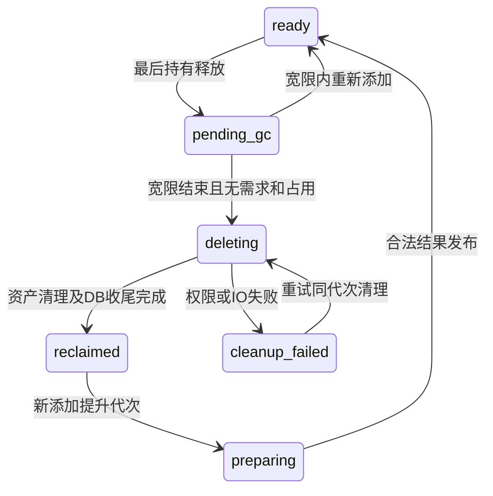

# 多用户、来源凭证与共享资源池执行计划

制定日期：2026-10-14。代码基线：6bedcb6（v2.5.1之后的文档清理）。P0契约见[多用户契约](multi-user-contracts.md)，P1见[共享池架构](resource-pool-architecture.md)，P2见[账号策略](account-policy-architecture.md)。P3存储/范围消费者已完成隔离实现；P4模型/内部核心正在实施，P5账本/读取核心正在实施，P6–P8仍**尚未实现**，普通用户登录继续关闭。本轮后续已获SQLite迁移授权；执行范围为隔离数据库，未导入现有实例、发布或清理资源。实施时重新核对HEAD、迁移叶节点和目标配置；当前开发迁移叶节点为0046。

## 1. 目标与首版范围

支持多个启用账号并发操作，个人状态/设置/凭证隔离；公共资源只准备一份，用户通过持有关系加入自己的库，最后一份持有释放后安全回收。管理员管理共享系统，普通用户不能删除他人资源或停止他人仍需要的工作。

首版采用以下设计默认值，已由[P0 ADR](multi-user-contracts.md)冻结；后续改变时先更新ADR及权限测试，再改消费者：

- 存储共享、用户库独立。共享池不是全员自动拥有的资源库；公开搜索摘要可以发现，正式详情、封面、视频和播放请求须有有效持有或管理员权限。跨账号凭证范围另行核查。
- 用户点击添加才建立持有；收藏/已观看/历史、事实缓存不自动算持有。稍后再看限定自己的有效持有；移出库时清除稍后再看、关闭新编辑/播放入口；宽限期内个人标记可暂留供再次添加，正式AVResource回收后原收藏/观看/备注按既有级联规则清理，历史快照和个人进度保留。若要永久保留备注/标记，须在P0另定稳定身份迁移，不默认承诺恢复。
- 公开资源可在身份、来源、规格与授权兼容时复用；私有凭证结果默认私有，不因为AVID相同就公开其媒体或鉴权上下文。
- 普通用户退出库只释放自己的关系。管理员强制下架立即阻止新访问，物理清理仍须停止写入者并处理读取占用。
- 自动回收为异步、有宽限期、可重试过程；建议初始宽限24小时，可由管理员配置。该数值不是当前配置默认值。
- 保留历史标题/番号快照及个人进度，资源已回收时明确不可播放；不以历史记录阻止回收。历史快照策略须在P0冻结，P6完成关系迁移后才启用自动删除。
- 不做评分、开放注册、任意命名播放列表、匿名分享、多宿主机存储集群或个人代理配置。Proxy.url与下载代理的现有用途分工保持。

## 2. 现状与必须改变的消费者

| 当前入口                           | 已有行为                                             | 计划变化                                                |
| ---------------------------------- | ---------------------------------------------------- | ------------------------------------------------------- |
| access.py/is_operator              | 仅指定启用账号可访问                                 | 启用用户准入＋明确管理员/对象权限，P8前不开放普通账号   |
| SourceCookie/CookieRepository      | 每来源一行，全局Cookie/UA/有效期/路线快照，版本校验  | 凭证归属与来源会话分离；所有读取、缓存、刷新显式带范围  |
| TaskRecords.reserve                | kind:avid全局去重，其他owner加入被拒绝，paused也占位 | 私有请求订阅兼容共享执行；取消请求与停止执行分离        |
| ResourceDeletionService            | 正式资源/文件删除，活动任务或promoting日志阻止删除   | 普通移出关系；物理删除只由受控回收/管理员流程调用       |
| AVResource与ProviderFactsCache     | 正式资源和事实缓存独立，资源删除不删缓存             | 增加池身份/版本，缓存补凭证范围，不将事实TTL当持有      |
| UserResourceState/UserWatchHistory | 状态按user，资源删除级联，历史唯一(user,resource)    | 补持有授权；历史迁移至稳定身份/快照，回收不抹掉观看历史 |
| 播放session/progress               | 控制绑定具体登录，个人进度与共享标记独立             | 准备/媒体读取补持有和版本授权，明确资产读取占用         |
| 前端查询与恢复                     | 部分个人缓存已隔离，外部搜索句柄/blob仍有待补齐项    | 账号/登录epoch、凭证与领域revision隔离，登出/撤销失效   |

核对来源：[任务协议](task-control-architecture.md)、[推荐协议](recommendation-architecture.md)、[代理路由](proxy-routing.md)、[代理并发](proxy-concurrency.md)、[抓取缓存](resource-cache-architecture.md)、[观看列表](viewing-architecture.md)、[接口](interface.md)。播放实现另审计nassav/playback下records、progress、gateway、local_gateway、local_files及HTTP入口；当前保留的[本地播放与进度设计](local-playback-and-progress-design.md)作为历史设计参考，不替代源码核对。

## 3. 权限与管理员功能

授权顺序：登录与启用状态 → 动作权限 → 对象归属/持有 → 凭证/媒体范围 → 版本与执行代次。共享工作内部使用明确的系统执行身份，不借发起用户账号绕过授权；所有用户身份由服务端会话确定，不接受body中的owner。

| 动作                       | 普通用户                         | 管理员                                        |
| -------------------------- | -------------------------------- | --------------------------------------------- |
| 查看搜索公开摘要、申请添加 | 按来源能力/配额允许              | 同样受来源能力约束                            |
| 正式详情、封面、播放       | 自己有效持有且媒体范围允许       | 共享系统资源可管理；个人凭证媒体另按授权      |
| 移出库、修改标记/备注      | 仅自己                           | 管理入口不默认读取/编辑他人私密状态           |
| 刷新/下载                  | 提交自己需求，受配额/限流        | 可发维护需求、修复共享版本                    |
| 取消用户请求               | 仅自己，不影响其他订阅者         | 可管理异常请求并记录理由                      |
| 暂停/终止共享执行          | 不直接授予，见P4规则             | 可强制操作并提示受影响需求                    |
| 个人Cookie                 | 写入/更新/撤销自己的；不回显明文 | 查看状态/撤销，不提供读取明文界面             |
| 系统Cookie、代理、来源开关 | 禁止                             | 配置、验证、轮换、停用                        |
| 用户管理                   | 自己基本账号操作                 | 创建/邀请、角色、停用、重置登录凭证、撤销会话 |
| 存储/任务/播放配额         | 查看自己的使用量                 | 设置配额与全局限额                            |
| 下架与物理回收             | 不能删除共享资产                 | 下架、预览引用/占用、受控清理/重试            |
| 运维与审计                 | 仅自己可见状态                   | 队列/worker健康、回收失败、备份恢复及审计     |

管理员账号权限和Django超级用户/后台权限分开定义，不将所有is_staff账号直接放行业务。保留最后一个可用管理员保护，敏感管理动作要求理由、对象版本及幂等request_id；日志保存操作者、对象、动作、时间与结果，禁止Cookie、源站签名URL、密码或备注正文。管理员账号停用/删除须有独立恢复流程。

个人备注/历史不默认提供全员查询或导出。若后续需要隐私排障功能，作为新的受审计权限设计。配额建议按每用户完整媒体逻辑大小计入，物理磁盘同一版本只计一次，避免复用绕过配额；附加配额在同一短事务预留并按幂等结果释放，失败/取消/超时不能重复退还。

## 4. 目标模型与迁移草稿

所有模型声明全小写下划线db_table。以下按职责分批新增迁移，不预占0037及之后的编号；实际实施按当前叶节点生成，保留0036及更早历史迁移。

| 模型/表名草稿                                        | 关键字段/约束                                                                                  | 状态所有者                                               |
| ---------------------------------------------------- | ---------------------------------------------------------------------------------------------- | -------------------------------------------------------- |
| ResourcePoolEntry/nassav_resource_pool_entry         | 稳定UUID、规范资源身份唯一、nullable resource FK、state、generation、version、gc_after         | 池生命周期，先有身份后有AVResource                       |
| UserLibraryEntry/nassav_user_library_entry           | user/pool唯一、pending/active、期望规格/范围、version、joined_at/updated_at                    | 用户持有意图；pending有效请求也阻止整池回收              |
| SourceCredential/nassav_source_credential            | UUID、source、system/personal、nullable owner、ciphertext、key_id、version、revoked_at         | 凭证归属与撤销；scope/owner组合CHECK，分域唯一约束       |
| SourceSessionSnapshot/nassav_source_session_snapshot | credential、host、出口/浏览器上下文、加密Cookie/UA、版本、generation、有效期、状态             | 单个来源会话；显式上下文唯一/索引                        |
| UserResourceOperation/nassav_user_resource_operation | UUID、user、pool、action、规范work_spec_hash、request_id/payload_hash、state/version、work引用 | 用户请求，唯一(user,request_id)                          |
| TaskWorkSubscription/nassav_task_work_subscription   | operation/work唯一、active/detached、需求类型/版本                                             | 共享执行的有效需求，关联既有TaskJob/attempt              |
| ResourceVersion/nassav_resource_version              | pool/version唯一、来源/媒体规格、access_scope、状态、资产manifest                              | 不可变可用版本；私有凭证版本不能被普通持有关系公开       |
| ResourceUseLease/nassav_resource_use_lease           | pool/version、kind、owner、到期/心跳、generation、关联session/work                             | 读取等临时占用；已有持久任务/promoting日志仍是强保护条件 |
| ResourceGcJob/nassav_resource_gc_job                 | pool/generation、claim owner、state、cleanup_state、错误/重试时间                              | 可恢复的物理清理，不以业务终态代替清理完成               |
| AuditEvent/nassav_audit_event                        | actor/action/object/request_id/time/result，脱敏细节                                           | 管理及关键授权审计，定义保留期与有界清理                 |

模型不是同时一次建完：P1建池/持有，P2权限/审计及配额所需持久记录，P3凭证/快照，P4请求/订阅，P5版本/读取占用，P6清理。按实际职责决定配额独立表，不为单字段配置增加泛化框架。

迁移采取扩展 → 显式回填 → 统一读写切换 → 最后清理旧字段。旧AVResource创建池条目，但既有资源的持有者须由操作者显式确认，默认不按收藏/历史反推归属；回填预览列数量、目标账号和异常身份，不移动媒体文件。旧全局Cookie先加密迁为系统凭证，不复制给全部用户；旧表在兼容窗口只作只读/回退来源，不能双向混写。遇到无法确认账号类型的Cookie按待审核状态处理。

既有资源生成初始版本映射时核查正式文件/marker，不因磁盘目录残留宣称版本有效。旧TaskJob/attempt继续收尾，不直接把旧owner任务变成共享任务；切换前停止/迁完活跃执行或使用明确只读兼容适配。历史回填稳定pool身份、标题/AVID/来源快照后才移除强级联关系；不凭空添加观看事件。

迁移测试覆盖SQLite及UTF8 PostgreSQL升级、回退、再次升级、NULL/条件唯一约束、Unicode、关系和业务数据保持。导入命令默认预览，仅显式apply写入，保留已编辑数据、幂等，拒绝不明确冲突。每批回退的数据损失/重复身份约束随迁移文档注明；不可安全回退时从备份恢复，不强删用户数据恢复旧约束。

## 5. 来源Cookie与缓存协议

CredentialResolver向查询、推荐、刮削、下载准备和播放提供不可变凭证引用/有效会话，不暴露全局可变Cookie。每次并发操作拥有独立HTTP jar/浏览器上下文；用户A的Set-Cookie不能改用户B的会话。来源凭证优先级由请求选择或已保存合法偏好决定，不因个人失败静默改用另一用户凭证；是否退回系统凭证作为显式策略并提示。

刷新过程：读取凭证/快照版本 → 按credential身份＋host＋出口/浏览器上下文领取owner租约 → 事务外验证目标业务页 → 短条件事务检查凭证仍有效、版本/generation/租约及执行身份 → 发布 → 仅释放自己的租约。人工改写/撤销递增版本，使旧刷新及缓存结果失效；不能upsert复活已撤销凭证。UA/上下文变化形成新快照，出口摘要不是实际出口一致性证明，仍需目标环境验证。

正常会话读取不拿刷新锁；刷新同域去重，失败有有界退避，不能触发全站刷新风暴。共享会话是否可并发由通用会话能力声明，必要时限制为1或选择独立会话池；ProxyServer接收session范围限额，仍受全局Redis容量限制，避免嵌套槽位死锁，不按Byparr/provider分支调度。

凭证加密使用专用可轮换服务端密钥/key_id，备份恢复必须包含受保护密钥；密钥缺失时明确不可用，不回退明文。HTTP只返回状态/最后验证时间/掩码，不回传完整Cookie；历史读取明文接口仅在旧operator兼容期保留，开放普通用户前停用。任务参数保存凭证ID及执行绑定的版本，不保存Cookie；实际敏感快照只留于受保护存储/执行内存，媒体会话不在URL暴露凭证。

缓存键显式隔离system/personal身份、凭证版本、host、出口和解析版本；缓存不得仅靠user_id/AVID。公开事实与私有结果分别发布：个人登录特有元数据、签名播放URL、鉴权headers默认不能进入公共复用域。公开元数据提升需明确可共享证据/策略，首版默认关闭个人产物提升；共享库持有不能授予他人私有媒体权限。撤销凭证阻断未来prepare/刷新/提交，并按会话依赖关闭相关播放；已授权生成的长期资产是否保留按冻结的共享策略处理，不自动将其开放。

## 6. 持有、任务与版本协议

### 6.1 添加与复用

1. 校验身份、来源/凭证权限、配额和规范化请求；以user/request_id幂等，同键不同payload返回409。
2. 短事务锁pool行，建立pending持有和用户operation；pending_gc时取消回收并提升generation，deleting或cleanup_failed时返回可重试冲突，不授予旧文件；reclaimed时提升代次重新准备。
3. 从兼容且授权的ready版本选择结果。有完整结果则直接转active，配额仍按用户逻辑大小核查；过期m3u8不算可复用媒体会话。
4. 无结果则加入匹配work_spec_hash的共享执行，或先持久化执行/派发记录再由Celery运输ID。规格至少包含pool身份、动作、来源/媒体规格、凭证/共享域及要求的事实版本，不含原始秘密。
5. 事务外准备，提交同时检查attempt/execution/generation、pool代次、凭证版本及需求仍有效；失败保持旧版本，用户operation独立记录失败；首次添加最后一个需求失败/取消时释放其pending关系和配额预留，但不移除已有active持有，也不在资产清理完成前解除writer保护。
6. 对仍有效订阅发布授权快照，用户operation成功后持有转active。取消后迟到成功不得重新建立该用户持有。

不同来源/字幕/媒体规格不得只凭AVID去重。相同公开资源可共用公开执行；A的个人凭证执行不能直接接受B订阅。任务发起者不是共享执行永久控制者，共享worker使用系统执行授权和明确凭证引用，审计保留发起信息。

### 6.2 取消、暂停与终止

普通用户取消自己的operation会原子脱离订阅并清理该请求的pending意图/配额；仍有有效需求时共享执行继续。最后需求撤销时请求停止，并等待既有停止证明/资产清理，不能直接置执行cancelled后删文件。复用的正式资源不因一次取消回滚。

普通用户第一版不控制共享worker暂停/恢复，只提供“取消我的请求”；管理员才可暂停/恢复/终止共享执行。若后续增加“暂停我的需求”，必须单独定义用户订阅状态，不能复用TaskJob.paused。paused工作占用、失效订阅及恢复代次沿用当前协议，管理员终止须通知仍在等待的用户并保留失败/取消原因。

退出库与取消操作分开：有共享需求时移出自己库要先撤销自己的关联需求，不能撤销他人。账号停用/删除同理，先撤销该账号会话/个人凭证和订阅，再删除持有；共享系统工作有其他需求时继续。网络失败保留幂等ID，前端只中止轮询不能算后端取消。

### 6.3 更新与播放版本

普通用户提交刷新需求，按资源版本/配额/冷却时间合并兼容执行；管理员可提交维护刷新。元数据、图片、翻译和媒体准备结果以新版本发布，失败保留旧可用内容；个人标记/备注不随共享事实更新重置。翻译使用当前共享翻译规则，未来用户自选语言/模型须增加独立规格，不让用户覆盖所有人的译文。

媒体版本目录及manifest不可变，当前版本指针在短提交中切换；覆盖现有正在读取文件的方式必须逐步退出。播放session固定具体授权版本，正常刷新仍检查原身份/代次，不因池更新套用新媒体时间轴。旧版本仅在无持有需求、播放占用、写入/补偿日志时回收。新prepare/claim、详情、封面与缩略图要求有效持有；既有播放的清单、密钥、分片、Range/HEAD须检查登录、版本、凭证范围及下述受限读取授权，不能只检查曾经登录。普通移出后的已有播放是否允许完成按7.2规则执行，登录绑定与进度writer规则保持。每一版本按有效需求的规格/授权范围核算引用，B持有公开版本不会永久保护A已无人需要的私有版本；旧版本读取pin和当前版本指针单独检查。

## 7. 锁顺序、回收与故障恢复

### 7.1 锁与代次

- DB的pool行和关系唯一约束是持有与生命周期真相；ref_count可作投影，不能作为单独删除依据。跨用户添加/释放、配额预留按同pool串行化，用户内个人状态仍沿用已有user fence。
- 任务执行使用既有owner租约/attempt/generation，资源发布再检查pool generation和版本；仅拿Redis锁不足以防失租进程写文件。
- 文件操作复用resource_file_locks和TaskAssetTarget。文件锁顺序保持task → resource → 按规范路径排序的target；只有取得文件锁后才进入必要的短DB提交，不在DB事务里等文件锁。
- 多DB行的锁顺序在P0/P1冻结：需要user fence的操作先user，再按规范身份排序pool，再operation/work相关行；禁止另一路pool→user。共享系统发布只锁所需pool/work，不为了通知用户在持锁事务中遍历取得user fence。
- 网络、下载、复制、大文件哈希和broker发送不进入短DB事务。对慢步骤使用资产日志/条件提交补偿；稳定flock文件不在线unlink。
- 首版单宿主机、各容器同一支持flock的共享文件系统。未来多宿主机须另做分布式协调和条件发布设计，不能以当前锁协议直接部署。

### 7.2 回收状态机



pending_gc只标记，不立刻删文件。GC由持久记录＋后台有界派发执行；多个scheduler/worker重复领取只能有一个owner。检查pending/active持有、有效订阅、活跃/暂停任务、读取占用、promoting/补偿日志和管理员保留标记；TaskJob状态终止但清理未完成仍禁止回收。

GC取得共享文件锁后，在短事务中再次检查引用/占用及gc_after，CAS进入deleting并保存claim owner/generation；随后事务外执行日志化删除。所有新attach/播放lease申请同时锁同pool并拒绝deleting，因此删除检查与新引用不能穿透。进入deleting后不允许原地复活；第一版返回409和结构化retry_after_seconds，客户端保留输入并允许重试，不宣称HTTP Retry-After本身会自动重试。

删除前校验目标版本/marker/路径归属，按资产日志幂等推进。崩溃后由恢复任务检查owner、停止证明和已完成资产记录；缺失文件可按已确认日志收尾，身份不明则保留现场。清理失败保留tombstone及错误，不回到ready暴露残缺文件；再次添加须等该代次收尾后准备新代次。

只有最后一个用户移出仍不代表可以杀死正在读取的文件。首版默认普通移出允许已有授权播放在既有绝对期限内完成，但拒绝新会话/接续；只有此前合法创建且固定版本的session获得该受限读取授权，不延长期限或授予其他请求，版本读取占用保护资产；管理员强制下架立即拒绝后续读取，关闭对应会话并等待句柄/worker退出。两种撤销语义由P0冻结，客户端不能自行延长授权。占用租约过期不等于writer停止，未知活跃写入者仍按现有TaskArtifact恢复规则阻止删除。

共享头像、同内容资产、缓存和历史分别处理：头像仍被其他资源引用时保留；仅清理属于该版本的文件，不清空公共目录。原站事实缓存按TTL独立保留、只清缓存记录。历史快照没有媒体访问权，回收后显示“资源已移出/不可播放”，个人进度保持已有AVID账本及清除墓碑协议。

## 8. 接口与前端草稿

下表是候选地址，不是当前可调用接口。P0核对现有URL/envelope后冻结，迁移API不采用悄悄改变旧DELETE含义的方式。

| 入口草稿                                              | 行为/关键契约                                                             |
| ----------------------------------------------------- | ------------------------------------------------------------------------- |
| POST /api/library/entries                             | 建持有/需求，返回用户operation及复用/排队结果；user由会话确定             |
| GET /api/library/entries                              | 只列当前用户的有效/pending库及个人投影，分页/排序保持稳定                 |
| DELETE /api/library/entries/{id}                      | CAS释放当前用户关系，返回released/gc_scheduled，不声称文件已删除          |
| POST /api/library/entries/{id}/operations             | 请求刷新/下载，带request_id和期望版本/规格                                |
| GET /api/my-operations/{id}                           | 私有请求快照，operation_id/version/allowed_actions；共享job信息仅安全摘要 |
| POST /api/my-operations/{id}/cancel                   | 仅取消自己的需求，返回是否仍有共享执行，不泄露他人身份/数量细节           |
| GET/PUT/DELETE /api/me/source-credentials/{id}        | 自己凭证元信息/盲写/撤销；GET不返秘密，PUT带expected_version              |
| /api/admin/users、source-credentials、resources、work | 按明确动作权限管理，版本/幂等/理由/审计齐备                               |
| /api/admin/resource-gc                                | 预览阻塞条件、执行或重试受控回收，无直接路径删除接口                      |

沿用code/message/data/pagination与CSRF；跨账号对象通常404，已认证但无动作权限403，版本冲突409，参数400，配额按冻结契约返回明确错误码。旧资源DELETE在兼容期仅管理员保留原全局语义，普通用户禁止；前端按钮改“移出我的资源库”。普通用户不直接消费其他人的TaskJob owner快照。

共享job的version和用户operation version分别存在，前端taskJobs/view-model按用户operation身份合并，不以AVID或原共享job ID冒充自己的可控任务。WebSocket只推所属用户安全版本提示，补取授权快照，管理员频道单独授权；资源版本事件不包含持有者/凭证/备注。

个人缓存key增加账号＋登录epoch＋领域revision，必要时带credential/media scope；注销、角色/持有撤销和凭证改写使旧响应/恢复句柄/blob失效。外部搜索token从签名持有进一步绑定用户/授权上下文，不能恢复旧账号任务；共享公开搜索内容命中后重新计算is_in_my_library、黑名单和可执行动作，不能用全局库存禁用“加入我的库”。个人响应不进入公共HTTP缓存，图片/Range即使命中缓存也须受授权入口控制。

## 9. 分阶段执行

各阶段使用新分支，从当时最新idle开始；阶段内按模型→核心→HTTP/前端→文档拆聚焦提交，阶段门槛全部通过后合并idle。门槛无法达成就停止该阶段合并，与用户沟通，不靠跳过失败检查推进。

| 阶段/建议分支                          | 依赖   | 必须交付                                                                                  | 阶段验收与停止条件                                                                           |
| -------------------------------------- | ------ | ----------------------------------------------------------------------------------------- | -------------------------------------------------------------------------------------------- |
| P0 doc/multi-user-contracts            | 本计划 | ADR冻结权限、资源身份、凭证共享、移出/下架、历史、配额语义；全部入口/锁顺序清单及响应样例 | 全部消费者有状态/授权所有者；未决项不得当已批准行为                                          |
| P1 feat/resource-pool-membership       | P0     | 池/持有模型，显式旧资源归属预览/回填，attach/release核心；自动回收关闭                    | 双用户/重复添加只有唯一关系，pending计入保护，零持有只标记；SQLite/PG往返数据保持            |
| P2 feat/multi-user-policy-admin        | P1     | 动作/对象授权模块、管理员基础管理与审计、配额预留、停用/会话撤销；operator生产门禁保留    | HTTP/WS/媒体/图片全入口负向授权矩阵；普通用户不能调用旧全局删除/控制                         |
| P3 feat/scoped-source-credentials      | P2     | 系统/个人凭证与快照迁移、密钥轮换、范围resolver、刷新fence、缓存域及ProxyServer会话限额   | A/B不串Cookie，旧刷新不能覆盖人工改写/撤销；私有事实/链接不公共发布；密钥丢失明确失败        |
| P4 feat/shared-work-subscriptions      | P1–P3  | 用户operation/订阅、兼容规格去重、持久派发、独立取消、管理员共享控制、用户快照/WS         | 同公共规格抓取一次；取消A不停止B；最后订阅撤销后确认停止；旧成功不重建持有；broker故障可恢复 |
| P5 feat/resource-version-publication   | P4     | 版本/资产manifest、当前指针、下载/刷新发布、读取占用与授权版本绑定                        | 更新失败旧版可用；播放固定旧版；不同媒体/凭证范围不合并；失租发布无成功副作用                |
| P6 feat/resource-pool-gc               | P5     | 历史快照迁移、GC状态机/宽限/有界调度、资产引用、失败恢复/管理预览；自动apply仍关闭        | 添加对最后释放/GC竞态可线性解释；无活跃writer/读者误删；多次恢复幂等；不删其他资源头像/缓存  |
| P7 feat/multi-user-library-ui          | P2–P6  | 我的库/移出、操作订阅、个人Cookie盲写、管理员页面、账户/域缓存、错误与重试                | 两真实账号浏览器隔离；公共结果可加入各自库；控件五态/键盘/弹窗/深浅/窄屏通过，旧缓存不串账号 |
| P8 chore/multi-user-release-acceptance | P0–P7  | 统一部署/迁移/回填指南，双用户真实worker/来源/GC故障验收，管理员恢复演练                  | 目标验收通过后逐步启普通账号，再启自动GC；任一越权/误删/共享停止问题阻断开放                 |

P7界面原型/只读装配可提前，但不能在P2–P6协议未完成时开放真实动作。P2首先覆盖管理员用户/角色/会话/来源/任务基础；配额界面、GC面板和敏感运维动作分别随对应后端阶段交付，不能做前端假成功。备份恢复仍走维护窗口命令，不默认开放一键破坏性恢复。

建议开关在实施时统一进入启动配置契约：多用户准入、共享池读写切换、GC自动apply默认关闭，回收宽限/批次/重试、会话范围容量有界校验；来源凭证与账户配额由DB持有。开关只能改变是否开放入口，不用关闭功能绕过数据授权或假装回到旧数据结构。同步本地/Compose配置样例；不在实现前增加无消费者配置项。

## 10. 测试矩阵与质量门槛

| 场景                                          | 必须证明的结果                                                    |
| --------------------------------------------- | ----------------------------------------------------------------- |
| A/B同时首次添加，相同/不同request_id          | 一份兼容工作、各一份持有；重复同键不扣两次配额                    |
| A/B来源或私有凭证不同                         | 不串会话、不泄露签名URL，不误加入私有执行                         |
| A取消、B等待；最后需求取消；暂停/恢复         | 各用户结果正确，共享执行仅按冻结控制规则停止，新attempt拒绝旧提交 |
| 取消后迟到成功、broker派发重复、worker重启    | 不复活用户关系，派发/事件幂等，可按持久记录恢复                   |
| 最后释放与新添加、GC标记/claim/删除各节点竞争 | pending_gc可取消；deleting明确可重试；不会成功授权已删除文件      |
| 更新与播放/下载/旧版本GC并发                  | 当前指针原子切换，旧读取可完成，旧writer不能覆盖新版本            |
| 刷新与Cookie人工更新/撤销/密钥轮换并发        | 持久/Redis/进程缓存都不能恢复旧凭证；匿名/私有范围正确            |
| Redis/代理/浏览器/数据库不可用                | 不绕过授权、限流或lease检查，失败/部分成功明确且不发布假成功      |
| EPERM、复制/删除失败、进程被杀、promoting残留 | 资产日志可恢复，未证明停止保留现场，清理终态独立，错误可审计      |
| 账号停用/删除、角色降级、管理员下架           | 请求/会话/订阅及时撤销，旧WS/token/blob不能继续发新授权请求       |
| URL/UUID猜测、跨用户分页/封面/Range/缓存恢复  | 全入口拒绝越权，普通用户不见其他人的Cookie/备注/任务参数          |
| 大量无持有资源、过期占用、重复调度            | 清理有界、索引覆盖、无全表无限扫描，过期租约不替代writer停止证明  |

实现阶段至少执行根pre-commit run -a；后端变更执行完整隔离pytest，新增迁移另在SQLite/PostgreSQL覆盖升级→回退→再次升级。前端代码执行pnpm run check，交互/主题/生命周期另做Playwright。模拟API、eager任务、传参测试只证明其层级，不替代真实worker、ProxyServer、来源或正式数据库。

```bash
pre-commit run -a
cd django_backend
uv run pytest tests/ --ds=django_project.refactoring_test_settings -v
# 回到仓库根目录后进入前端
cd ../vue_frontend
pnpm run check
```

并发验收使用可控barrier/故障注入与独立事务，不只靠串行调用或sleep制造概率；断言调用次数、授权快照、资产路径/marker、有效关系和占用。负载目标由P0结合部署资源冻结：记录N用户、每用户M并发、后端峰值/延迟、ProxyServer上限及清理批次，不在未测量前承诺性能数字。至少覆盖两独立用户和同用户双登录，不能只用双登录证明跨用户隔离。

## 11. 上线与回退

1. 核对引擎/叶节点、资产目录、共享文件系统能力、密钥备份、旧operator、活跃任务/session及全部消费者版本；备份DB/配置/媒体恢复点。
2. 先做隔离库和目标模式预演，关闭业务新提交，停止所有旧写入者，按现有停止协议处理活跃执行，禁止混跑。
3. 新版迁移及只读导入预览，人工确认归属后apply；核对资源/文件数、关系数、初始版本、Cookie分类和加密状态，记录异常而不默默丢弃。
4. 所有消费者统一版本，operator门禁保持，仅管理员验证新库和共享工作；GC先dry-run，核对候选/阻塞原因。
5. P8验收通过后按受控账号逐步打开普通用户；监测授权拒绝、重复工作、配额差异、刷新冲突、清理失败及代理容量。
6. 再启有宽限、有界批次的自动GC；首批逐项抽查，保留审计与回退恢复点。

回退首先关闭普通账号/自动GC/新任务，不直接切旧镜像。停止新消费者，备份新增关系/私有凭证/操作/版本/历史快照，再依据实际迁移图用新代码逆向；用户持有与私有凭证无法用旧全局表表达，不能自动压成一份Cookie或共享收藏。已回收媒体不能由DB逆向迁移重建，须从备份恢复或重新准备；新多版本目录旧代码不能识别时保持维护窗口并恢复匹配文件布局。不存在安全回退映射时前向修复或整体恢复，不为启动旧代码删除冲突行。

## 12. 阶段完成判定与本文件维护

每阶段更新接口、数据库、任务/缓存/代理/观看职责、配置及必要前端契约，CHANGES写当时未发布分类，已发布历史不改。执行记录包括基线/分支/提交、命令退出码、通过/跳过、迁移数据检查、API模拟/真实worker/目标验收范围及未决问题；不把本计划标成已实现。

| 阶段  | 当前状态       | 完成证据                                                                                                       |
| ----- | -------------- | -------------------------------------------------------------------------------------------------------------- |
| P0    | 契约已交付     | [ADR、实际消费者/锁顺序、响应样例与验证范围](multi-user-contracts.md)；仅文档                                  |
| P1    | 基础已实现     | 0037、内部持有与显式导入；SQLite及独立PostgreSQL专项通过，见[执行记录](resource-pool-architecture.md#执行记录) |
| P2    | 基础已实现     | 0038/0039、显式应用角色/审计/管理/配额/会话撤销；[执行记录](account-policy-architecture.md#执行记录)           |
| P3    | 隔离实现已完成 | 0040/0041存储、范围消费者及密钥策略；生产开关保持关闭，真实站点验收待P8                                        |
| P4    | 子阶段已实现   | 0042–0046订阅、生命周期、worker、持有命令与配额；消费者切换继续实施                                            |
| P5    | 子阶段已实现   | 0044/0045不可变发布与读取核心；正式资源/媒体消费者待接入                                                       |
| P6–P8 | 待实施         | 未开放普通用户或自动回收                                                                                       |

初始计划提交ae10475，文档基线6bedcb6，分支doc/multi-user-shared-pool-plan；当时仅编写计划及导航。P0后续执行基线ae10475、分支doc/multi-user-contracts，记录见[契约验证范围](multi-user-contracts.md#验证记录与后续门槛)。两轮均检查新增链接及pre-commit完整门槛，未新增模型、接口、配置、worker或正式数据写入，也未恢复用户删除的历史文档。

### P3存储子阶段记录

0040与加密凭证/快照、盲写HTTP、导入及轮换先落地，详见[凭证架构](source-credential-architecture.md)。P3仍在执行：来源工厂、网络会话、缓存发布及ProxyServer范围能力尚待切换；不把子阶段当完整P3。

存储子阶段隔离门槛（2026-10-15）：全量SQLite `uv run pytest tests/ --ds=django_project.refactoring_test_settings -v` 为1062 passed、28 skipped；临时PostgreSQL专项为21 passed；`makemigrations --check --dry-run`无差异。`pre-commit run -a`全仓检查通过后提交。28项在线/opt-in跳过未当作目标环境通过；未执行现有实例迁移、Cookie导入或管理员引导。

### P3范围消费者记录

独立分支`feat/scoped-source-runtime`：0041 key policy、可选新来源模式、范围resolver/fork、ProxyServer能力、先领取刷新租约及有界复用、缓存和推荐提交fence、系统源播放引用/撤销及配套UA。详情见[凭证架构](source-credential-architecture.md#范围消费者与运行切换)。

2026-10-15隔离门槛：全量SQLite1078 passed/28 skipped；PostgreSQL专项37 passed；模型迁移无差异；`pre-commit run -a`全部通过。修复两个验收辅助问题：失败逆向迁移测试恢复最新schema，跨进程容量测试在统一启动屏障后开始等待预算，原容量断言保留。真实站点账户/代理出口、普通账号准入、私人任务资产、版本与GC仍须后续验收；当前配置默认旧模式，现有实例未迁移。P4–P8继续待实施。

### P4模型/核心子阶段

新增0042及内部请求/订阅/独立取消，详见[共享工作架构](shared-work-architecture.md)。完整P4仍在执行：配额、HTTP、worker规范/终态投影与事件尚未接入；私人发布依赖P5，不使用旧公开资源写入路径。没有在现有实例创建请求或派发共享任务。

P4模型/核心隔离门槛（2026-10-15）：SQLite全量1087 passed、28 skipped；临时PostgreSQL专项9 passed；模型迁移无差异；完整pre-commit通过。分支`feat/shared-work-subscriptions`，基线321614e；仅隔离数据库，没有真实共享worker/发布联调。

P4生命周期子阶段基线e2682f1，分支`feat/shared-work-lifecycle`：0043逐用户游标、后台有界进度/失败投影、移出/停用联动、事务后私有提示以及旧派发/领取保护。完整P4的成功激活、配额及HTTP仍待P5发布协议接入，不开放普通账号。

生命周期子阶段隔离门槛（2026-10-15）：全量SQLite1101 passed、28 skipped；临时PostgreSQL专项41 passed；模型迁移无差异；完整pre-commit通过。执行记录不包含真实共享Celery、源站账号、正式媒体或部署数据库验收。

P5账本子阶段基线d57421c，分支`feat/resource-version-ledger`：0044及内部读取占用，详见[资源版本](resource-version-architecture.md)。尚未接入正式发布、播放器/封面/GC及旧文件导入，完整P4/P5仍在执行。

P5账本隔离门槛（2026-10-15）：全量SQLite1111 passed、28 skipped；临时PostgreSQL专项10 passed；模型迁移无差异；完整pre-commit通过。仅DB/授权占用核心，未打开媒体或验证真实版本发布。

P5发布核心子阶段基线04e0214，分支`feat/scoped-version-publication`：0045、冻结来源fence、版本文件命名空间、指针CAS/资产日志、注入成功持有激活及来源失效收尾。真实worker/HTTP/配额、正式库和媒体投影、GC仍待接入；生产共享派发继续关闭。

P5发布核心隔离门槛（2026-10-15）：全量SQLite1125 passed、28 skipped；临时PostgreSQL专项38 passed；模型迁移无差异；完整pre-commit通过。专项含实际生成并完整解码的0.2秒MP4及真实文件日志/线程竞争；未进行来源下载、真实Celery或HTTP媒体联调。SQLite并发控制只读检查采用有界重试，不重跑文件提升。

共享执行器子阶段基线5980af4，分支`feat/shared-version-workers`：受控流程策略、ID-only持久派发/worker、范围来源装配/全局代理、翻译先于不可变发布、独立下载租约及默认关闭开关。尚无共享库HTTP/配额、正式版本查询/媒体/GC或普通登录开放；完整P4/P5仍在执行。

共享执行器隔离门槛（2026-10-15）：全量SQLite1140 passed、28 skipped；临时PostgreSQL专项75 passed；模型迁移无差异；完整pre-commit通过。默认装配检查覆盖独立来源及全局scraper代理，真实临时Redis验证租约与恢复；来源/下载替身只证明编排，不代表真实worker/站点下载、HTTP版本读取或正式实例已迁移。

持有命令/配额子阶段基线4e964fd，分支`feat/library-commands-quota`：0046、本人命令回执/意图代次、ready复用、每持有者逻辑配额和HTTP写入/任务快照。库/目录/推荐/媒体版本投影、GC及正式准入仍未完成，生产开关保持关闭。

持有命令/配额隔离门槛（2026-10-15）：全量SQLite1155 passed、28 skipped；随后补齐配额HTTP错误码及专用动作校验，HTTP/旧契约专项11 passed；临时PostgreSQL17 passed，含0046往返。模型迁移无差异，完整pre-commit通过。旧HTTP快照保留，只精确登记授权新增URL。未启用现有实例共享模式、没有真实Celery/媒体验收。

本人库/版本图片子阶段基线d0cf4f0，分支feat/version-library-reads：批量本人投影、旧读取入口的可选切换、登录绑定图片短占用、manifest/marker/内容及NOFOLLOW校验，个人写入在user fence内再次核查持有。无新schema。SQLite全量1170 passed/28 skipped，临时PostgreSQL40 passed，完整pre-commit通过后提交；真实播放器、目录/推荐、GC与前端/普通准入继续实施。详见[版本读取记录](resource-version-architecture.md#本人库与图片读取子阶段)。
