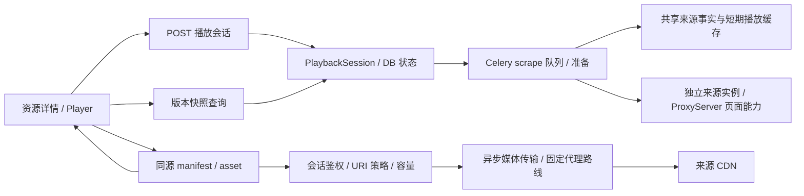

# 基于来源 HLS 的在线播放：调研、设计与执行计划

日期：2026-10-10。初始设计基线：`b91b5ac`。状态：**P0–P4 已完成实现与分层验证，P5 受控验收见[验收记录](online-playback-acceptance.md)**。初始调研为静态核查，后续已完成[两个来源样本的 P0 探测](online-playback-p0-report.md)：重新获取地址并真实解码、跳转、暂停及关闭。P0 未创建业务任务或修改部署；短时样本不能代替正式播放器、长期播放及目标设备验收。

## 可行性与范围

可以把刮削得到的 HLS 地址用于浏览器在线播放，前提是清单、分片、密钥等依赖可访问，且浏览器支持流的编码。建议采用同源播放网关：后端获取新鲜播放信息，转发 HLS 请求；前端通过 hls.js 或原生 HLS 播放。直接将数据库 m3u8 赋给 video.src 仅适用于原生支持 HLS、无跨站请求限制且链接有效的来源，不能作为项目默认方案。

[hls.js 官方说明](https://github.com/video-dev/hls.js)确认其依赖 MSE，支持 TS 转封装和 AES-128，但编码解码能力仍取决于浏览器/系统；Safari 可使用原生 HLS。它不能保证任意编码或 DRM 流都能播放。首期限定资源库内资源、VOD、H.264/AAC、普通 TS 与经验证的 fMP4、无 DRM 或 AES-128 identity；不承诺转码、直播、LL-HLS、SAMPLE-AES、DRM、投屏、边下载边播放本地临时文件或所有来源通用。

首期保持现有来源选择和画质：MissAV 目前解析后只返回最高码率媒体清单，未保留完整主清单，不能直接承诺自动码率或多画质切换。后续在来源播放描述保留主清单后再扩展。播放器能力检测只用于提前提示，仍须实际首帧与解码验收。

## 当前代码与缺口

| 当前实现                                         | 证据                                                                                          | 对在线播放的含义                                                                    |
| ------------------------------------------------ | --------------------------------------------------------------------------------------------- | ----------------------------------------------------------------------------------- |
| 详情页“点击播放”复制 file 路径                   | [ResourceDetailView](../../vue_frontend/src/views/ResourceDetailView.vue) 的 jumpPlay         | 尚无 video/hls.js 或服务端视频流入口；保留原功能，文案可明确为复制本地路径          |
| 来源信息带 m3u8，正式资源独立于事实缓存          | [AVDownloadInfo](../nassav/resource_data.py)、[缓存架构](resource-cache-architecture.md)      | 不信任旧 AVResource.m3u8 的永久有效性                                               |
| ProviderDownloadInfoResolver 使用来源准备器      | [解析器](../nassav/download_information.py)、[生产装配](../nassav/composition.py)             | 可复用新鲜事实与来源优先选择，不调用保存资源/下载工作流                             |
| 播放缓存默认 5 分钟，隔离出口/浏览器会话版本     | [provider_facts](../nassav/provider_facts.py)、[缓存模型](../nassav/resource_cache_models.py) | 可以复用链接，但 playback-v1 payload 只有 m3u8，缺少完整请求上下文                  |
| MissAV 主播放列表使用最终详情页 Referer          | [MissAV](../nassav/source/MissAV.py)、[代理路由](proxy-routing.md#missav-播放列表请求)        | Referer 可能包含重定向/字幕路径，不能只用来源首页；后续分片是否同样要求该头尚未实测 |
| 下载传入来源首页 Referer/固定 UA，媒体走下载代理 | [controlled_download](../nassav/controlled_download.py)                                       | 下载上下文不能原样视为在线播放上下文，尤其需要核查实际出口和 Cookie 作用域          |
| HTTP 运行在 Uvicorn/Django ASGI                  | [ASGI](../django_project/asgi.py)、[Nginx](../../vue_frontend/nginx.conf)                     | 需真正异步流式响应及独立播放 location，不能照搬同步图片入口                         |
| TaskNetworkControl 将完整响应读入 bytearray      | [task_network](../nassav/task_network.py)                                                     | 可用于有界准备/清单操作，不能直接用于视频分片转发                                   |

直接浏览器获取还受 CORS 约束：hls.js 的所有 HLS 请求都要满足跨域许可，no-cors 的 opaque 响应无法供播放器解析。前端不能任意设置 Cookie 或跨站详情页 Referer；Fetch referrer 只能指定同源 URL。因此同源网关更适合本项目已有的代理和反盗链环境。[CORS](https://developer.mozilla.org/en-US/docs/Web/HTTP/Guides/CORS)、[请求头限制](https://developer.mozilla.org/en-US/docs/Glossary/Forbidden_request_header)、[Fetch referrer](https://developer.mozilla.org/en-US/docs/Web/API/RequestInit#referrer)

## 推荐结构与流程

1. 用户主动点击“在线播放”，创建会话；前端展示准备状态，HTTP 请求不等待可能持续数十秒的来源浏览器抓取。
2. scrape worker 领取该会话的准备执行，优先读取相同来源、出口、解析版本的有效播放事实；缺少请求上下文或过期时重新获取来源。仅来源事实允许写入共享缓存，不刮削 JavBus、不翻译、不保存资源图片、不启动下载器。
3. 获取有界清单，判断支持范围，验证所有目标和请求上下文；准备完成后，DB 条件提交 ready 与新版本。前端获取授权快照后加载同源清单。
4. 清单中的上游 URI 注册为会话内不透明 asset_id；前端仅请求本系统的媒体入口，后端逐块转发分片/密钥/初始化片段。
5. 页面切换、重新打开或关闭播放器撤销旧会话，停止前端加载并释放上游请求。Celery 仅做准备；媒体分片走异步 HTTP，不经 broker 搬运视频字节。暂停播放只控制播放器加载，不改变下载/刮削任务，不删除任何正式或任务私有文件。

### 边界与依赖

- 新业务放在后端 playback 模块、前端 features/playback；HTTP 做登录/CSRF/参数及流响应适配，worker 只运输准备执行，composition 装配默认能力。
- PlaybackResolver 消费共享事实缓存和来源能力，返回独立 PlaybackDescriptor；不调用 ResourceDownloadInfoResolver 的兼容保存路径，不让播放器依赖下载目录、下载锁或 HLSResumeGuard 私有结构。
- PlaybackDescriptor 至少包含 media/master URL、实际详情页 Referer、受验证的 UA/Cookie 上下文引用、来源/解析版本、出口标识、获取/过期时间和已验证的媒体能力。Cookie 从受控会话记录按版本取得，只用于合法作用域；凭据不写公共元数据，不返回浏览器，也不跨 CDN 无条件复制站点 Cookie。
- 现有播放缓存仍由 ProviderFactsCache 持有。新增 online playback-v2 的能力/版本要求；旧 m3u8-only 行不能伪装为具有完整上下文的缓存命中。JSON 可扩展，但必须更新缓存版本/字段证据及来源适配；下载消费者契约保持，是否随后共用新描述需单独覆盖回归。
- 页面抓取并发继续消费公共 ProxyServer 能力，不面向 Byparr 调度。媒体传输单独定义 open_stream/close、代理路线、超时和容量能力；它不经过浏览器页面抓取服务，不占用 Byparr 页面槽位。

### 代理路线

默认在线播放的清单、密钥、分片使用准备描述中固定的来源路线（全局 Proxy.url，关闭时明确直连），以便保持页面/播放出口一致；不自动回退到 Proxy.download_url，也不继承系统代理。原下载行为不变。若 P0 证明某来源媒体必须走其他路线，先通过通用 PlaybackTransport 策略显式配置并验证，不在协调流程按 provider 名分支。

ProxyServer 代表页面 provider 的能力，不代表所有媒体必须经过该浏览器；Byparr 控制 transport 保持直连，浏览器页面出口仍按全局来源代理。配置摘要相同不能证明实际公网出口相同，P0 必须观察代理部署和实测结果。已有详情链接在下载出口有效，不代表在来源出口同样有效。

## 会话、数据库与接口草稿

建议新增独立 PlaybackSession 表 `nassav_playback_session`，不扩充 TaskJob 的下载/刮削含义，也不把播放混入任务列表。会话短期但需要跨 API/worker 的取消与提交 fence，因此 DB 持有状态；Redis 只保存有 TTL 的 URI 映射、少量清单及有租期的并发 owner。

| 字段组     | 草稿                                                                                 |
| ---------- | ------------------------------------------------------------------------------------ |
| 身份与归属 | UUID id、用户/登录会话摘要、资源 FK、source、created_at                              |
| 状态       | queued / resolving / ready / failed / closed、version、error_code、公开简短 message  |
| 准备执行   | execution_id、generation、owner、lease_until、deadline、派发/重试时间                |
| 播放上下文 | 服务端 descriptor JSON、路线/会话版本、manifest identity；不保存原始 Cookie/代理密码 |
| 生存期     | last_seen_at、idle_expires_at、absolute_expires_at、closed_at                        |

资源 FK 采用 CASCADE：删除资源撤销会话，不级联删来源事实缓存；缺失会话的旧执行不能提交。网络在事务外，准备完成和缓存发布在短事务中锁定当前会话，检查 execution/generation/owner/deadline。不能仅先读 Redis 再写 DB，以免取消和发布竞争。终态/超时的旧执行不得创建缓存行或恢复 ready；准备领取和容量释放使用 owner 条件更新。

迁移仅新增会话及状态/到期索引，不修改资源关系与历史表名迁移。具体迁移编号依据实施时最新叶节点生成，不预先硬编码。TTL 清理有界：默认建议空闲 30 分钟、绝对 4 小时、关闭/失败保留 24 小时供诊断；请求续期不能越过绝对期限。资源删除或到期后新媒体请求拒绝，在途流通过有界检查停止；Redis 映射清理及 capacity lease 回收不触碰资源目录或任务锁。

| 接口草稿                                                 | 行为                                                                                                     |
| -------------------------------------------------------- | -------------------------------------------------------------------------------------------------------- |
| POST `/api/resources/{avid}/playback-sessions`           | 登录＋CSRF，202 返回 session_id/version/state/status_url；只接受已入库资源，来源默认其已选且仍可用的来源 |
| GET `/api/playback-sessions/{id}`                        | 授权快照；ready 返回同源 manifest_url、支持信息及到期时间，不暴露上游 URL/凭据                           |
| POST `/api/playback-sessions/{id}/close`                 | expected_version/request_id 幂等关闭，旧准备执行和新分片失效；迟到关闭不能撤销另一新会话                 |
| POST `/api/playback-sessions/{id}/refresh`               | 有界失效刷新，创建新 generation，返回 202；不延长绝对期限                                                |
| GET `/api/playback-sessions/{id}/manifest/{asset_id}`    | 返回 HLS 文本，登录＋绑定会话/generation 的短期能力校验；所有依赖重写                                    |
| GET/HEAD `/api/playback-sessions/{id}/assets/{asset_id}` | 返回原媒体/密钥字节，支持单 Range 和 206/416；不得接收客户端 URL 或任意请求头                            |

除二进制/HLS 外仍沿用 code/message/data 包络。HTML video 与 Safari 原生 HLS 不方便附带自定义鉴权头，所以媒体入口使用同源登录 Cookie 和短期受限能力 URL；静态 VOD 清单中的能力期限以会话绝对期限为上限，每次请求仍检查空闲期限/关闭状态，不跟随 5 分钟事实 TTL 失效。主动轮换能力需要重新签发清单，不强制重新刮削来源。能力绑定 session/asset/generation，不能只凭 URL 绕过登录。URL/能力从日志脱敏，关闭和清单响应 no-store；首期媒体也禁止共享 HTTP 缓存。页面进入后台/浏览器关闭时 close 为尽力请求，不能依赖其必达，服务端期限负责兜底。

发布失败应显示 failed，而非无限 queued；DB 中保留待派发记录，由有界补派/失租扫描处理 broker 暂不可用与 worker 崩溃。Beat 或其他补偿驱动未启用时必须明确返回/展示该限制。仅复用已有调度模式，不为了本功能重构所有任务基础设施。

## HLS 转发与播放器细节

### 清单解析与请求约束

按 [RFC 8216](https://www.rfc-editor.org/rfc/rfc8216.html#section-4)解析 URI 行及 URI 属性：变体、分片、EXT-X-MEDIA、I-FRAME-STREAM-INF、KEY、SESSION-KEY、MAP、SESSION-DATA；保留相对地址的实际最终清单 URL 基准、签名 query、媒体序号、IV、CODECS、DISCONTINUITY 和 BYTERANGE。先验证完整清单再发布，覆盖子清单、密钥、初始化片段和逐跳重定向。未支持的 URI 扩展明确拒绝，不通过正则只替换 .ts/.m3u8，也不把下载续传校验器当通用解析器。

- 只允许受验证来源/CDN 的 HTTPS 域名和公开目标地址，拒绝用户信息、非允许端口、文件协议、回环/内网/链路本地及 IPv6 特殊目标；禁止任意 URL 转发。
- DNS 与重定向都受检查；直连解析/连接需绑定已验证地址。代理远端解析时，必须通过可信代理出口的目标 ACL/DNS 策略约束，不能声称只在 Django 解析一次域名就防住重绑定。代理地址本身可为内部基础设施，目标策略和代理控制地址分开校验。[SSRF 防护指导](https://cheatsheetseries.owasp.org/cheatsheets/Server_Side_Request_Forgery_Prevention_Cheat_Sheet.html)
- Range、响应状态及 Content-Range 保持一致，不伪造 206；首期多 Range 明确拒绝。不同 generation/URL 的 validator 不混用；不转发 Set-Cookie、跳转 Location、上游 Authorization 或 hop-by-hop 头。
- 上游 HTML 挑战/错误页不能当视频或密钥返回；清单大小、嵌套深度、URI 数量、分片字节数与超时有上限。AES-128 密钥正确转发，IV/轮换保持，不在后端做整片转码。

### 真正的流式传输

ASGI 下使用异步 StreamingHttpResponse iterator，ORM/会话检查在短同步桥接段完成，长期网络不占用事务，也不能把同步 DRF APIView 简单改一个 async def 就视为支持。Django 文档指出错误的迭代器类型会导致完整消费，断开时会取消协程，需 finally 关闭上游并释放容量。[Django 流响应](https://docs.djangoproject.com/en/6.0/ref/request-response/#streaminghttpresponse-objects)、[断开处理](https://docs.djangoproject.com/en/6.0/ref/request-response/#handling-disconnects)

P0 已确认当前 curl_cffi 0.14.0 的默认 AsyncSession 流使用无界队列，aclose 会等待剩余传输，不可直接用于生产媒体转发。来源准备保留现有实现；PlaybackTransport 优先评估独立 HTTPX Adapter：临时 HTTPX 0.28.1 已通过两个 CDN 的同代理清单/Range/密钥请求与本地慢消费者关闭实验，P2 已加入项目依赖。P2 必须进一步验证 ASGI 断连、多个慢客户端、代理/TLS/超时和内存上限，不把单次测量视为全局保证。[P0 测量](online-playback-p0-report.md#异步传输与缓存有效期)、[HTTPX 异步流契约](https://www.python-httpx.org/async/)、[curl_cffi 官方实现](https://curl-cffi.readthedocs.io/en/latest/_modules/curl_cffi/requests/session.html)

Nginx 为 `/nassav/api/playback-sessions/` 的媒体子路径单独关闭 buffering/cache，或允许 X-Accel-Buffering: no；避免产生代理临时视频文件，设置合理分片连接/读取超时。[Nginx buffering](https://nginx.org/en/docs/http/ngx_http_proxy_module.html#proxy_buffering)

容量独立于下载槽位，按用户/会话和服务整体限制，使用跨进程 owner 租约；释放只允许当前 owner。建议初始单用户 2 个播放会话、每会话 4 个并行媒体请求，全局额度与超时作为配置草稿，P0 后按实际码率调整。视频流量经过应用服务器：例如 5 Mbps 视频每小时约 2.25 GB 入站及 2.25 GB 出站，不会自动节省服务器带宽。

### 缓存、过期与关闭

- 5 分钟播放事实 TTL 是“何时重新解析链接”的策略，不等于视频只能播放 5 分钟，也不保证来源签名真实有效期；每次新准备检查上下文并验证根清单。
- 首期清单只做会话内短期缓存；分片/密钥不写 resource 或 .tasks，不建立持久磁盘视频缓存，浏览器只保留有限缓冲，防止播放器把整片逐步驻留内存。
- 对链接 401/403/404/410 可请求一次强制准备刷新，但 403 也可能是反盗链、出口或权限错误，不能一律标成链接过期。刷新是会话级 single flight，新 generation 替换旧 URI 映射，旧请求不得发布新结果。
- 前端暂停旧加载，记录 currentTime，重建并加载新清单；只有同媒体轨道、时间轴与加密/初始化指纹可确认时才恢复位置。有歧义就提示用户重新开始，不仅凭同 AVID 或去掉 URL query 认定内容相同；不承诺无缝刷新或字节级内容恒等。
- close、资源删除、会话过期、退出登录、路由卸载停止后续请求并关闭当前流。媒体响应已开始发送后无法再改成 JSON 错误，关闭流并由状态接口/播放器错误处理给出重试信息。

### 前端 UX

在资源详情加入“在线播放”，保留下载和复制本地路径入口。首期使用真正的 PlayerDialog（useDialog 生命周期）＋OnlinePlayer；通用按钮五态、准备超 1 秒平缓 loading、可解释的失败与重试。video 开启 controls/playsinline，用户点击后播放，自动播放被阻止时显示“点击播放”。优先原生 HLS 可用路径，否则 Hls.isSupported 后使用 hls.js；未支持编码/DRM 提示原因并保留下载入口。

前端组合函数拥有 session_id/version/generation 与请求 guard；组件拥有 video/hls 实例。切资源、刷新、卸载时取消轮询、abort 网络、stopLoad/destroy，清理 video.src 并恢复弹窗焦点；旧 ready/错误不覆盖新会话。播放暂停与后台下载暂停是两个动作，不互相联动；网络已在途或浏览器有限缓冲不保证点击暂停后瞬间零流量。

## 分阶段执行计划

每阶段仅在 `/tmp/nassav-agent-worktree` 新分支实现，通过门槛后提交合并 idle。P0 已完成两样本探测，结果与覆盖限制见[P0 报告](online-playback-p0-report.md)；P1/P2 已实现且默认关闭，见[实现契约](online-playback-architecture.md)；P3/P4 已完成，P5 的实测与未覆盖项见[验收记录](online-playback-acceptance.md)。

| 阶段                  | 交付                                                                                                                                                                       | 验收/停止条件                                                                                                                                                                |
| --------------------- | -------------------------------------------------------------------------------------------------------------------------------------------------------------------------- | ---------------------------------------------------------------------------------------------------------------------------------------------------------------------------- |
| P0 可行性探针         | Jable/MissAV 各选受控已知样本；验证根/子清单、密钥/首段与 init/range、Referer/UA/Cookie 与实际出口、codec/加密、来源 TTL；本机真实 video/hls.js 最小播放；验证异步传输背压 | 实际首帧、拖动、暂停/关闭；脱敏记录失败类型、码率、首帧时间及请求上下文，不能只以清单 HTTP 200 为通过；有来源不通先说明边界                                                  |
| P1 会话与播放描述     | PlaybackSession 可逆迁移、接口与 scrape worker 准备、权威版本/领取/取消/过期、补派；来源上下文和 playback-v2，保留下载消费者                                               | 热/冷/旧缓存缺上下文、权限/CSRF、重复消息、取消/删除与提交竞争、SQLite/PostgreSQL 迁移回退；无业务资源/资产保存副作用                                                        |
| P2 HLS 网关           | 解析/URI 注册、鉴权、域名/DNS/重定向策略、异步媒体转发、Range、容量和关闭清理、Nginx                                                                                       | 本地 TS/fMP4/AES-128、多级清单、相对/签名地址、URI 扩展、分片/密钥轮换、206/416、恶意目标、慢客户端、掉线/过期/worker 崩溃；测峰值内存与临时文件，无浏览器 provider 媒体请求 |
| P3 详情页播放器       | features/playback、原生/HLS.js 选择、五态按钮、loading/error/retry、焦点/卸载与位置恢复                                                                                    | Playwright 使用本地合成 HLS，验证真实解码/seek/关闭、乱序、主题、键盘与移动布局；mock API 只验状态，不替代真实视频解码                                                       |
| P4 有界失效恢复       | 会话刷新 single flight/new generation、媒体身份验证、TTL/后台清理和脱敏观测                                                                                                | 失效链接最多一次刷新、旧分片/ready 不回写、不兼容清单不自动跳播；多标签页、过期、退出登录及内存/连接回收                                                                     |
| P5 目标环境验收与文档 | 实际 Compose、反向代理/HTTPS、Jable/MissAV 样本长时播放、失败回退和部署/回滚说明                                                                                           | Chrome/Firefox、真实 Safari/iOS、Android 的首帧/seek/暂停/刷新；代理出口与容量、长时签名失效、服务器负载、与下载/刮削同时运行；真实 Safari 不能用 Playwright WebKit替代      |

P1/P2/P4 后端执行完整隔离 pytest 与 pre-commit；P3 前端执行 pnpm run check、对应 Playwright 和 pre-commit；迁移阶段另核对 makemigrations/sqlmigrate 与独立 PostgreSQL。失败门槛不合并，先与用户沟通。上线须备份、应用新增迁移、同步 API/worker/前端/Nginx/清理驱动，默认功能开关关闭，先开启单用户受控验收；回滚关闭入口并撤销会话，不影响下载/刮削/事实缓存。无旧表迁移尚未应用的实例先按现有维护窗口统一消费者版本。

## 本轮结论与证据范围

协议与浏览器能力调研完成后，P0 已验证 Jable/MissAV 各一个新获取地址，在 Chrome＋hls.js＋临时同源网关中完成实际解码和短时操作。P1–P4 已补齐请求上下文、DB 会话、异步受控网关、详情播放器与一次兼容刷新；不能保证全部资源、所有设备或长时链接失效后均可播放。生产媒体使用经验证的有界 curl 子进程传输，不使用默认 curl 异步流。

初始调研仅新增设计文档与导航；P0 后续提交增加来源、代理、真实浏览器及传输测量报告，不修改业务代码。短时网络探测不代替正式服务负载和目标设备验收；文档门槛为链接检查与根目录 pre-commit run -a，最终提交见 Git 历史。
