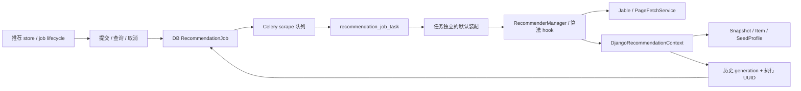

# 推荐架构与开发约束

本文维护当前实现，算法详见[推荐说明](recommendation.md)，传输字段见[接口](interface.md)，
部署与验证边界见[验证状态](validation-status.md)。下载/刮削的资产控制仍由
[任务架构](task-control-architecture.md)维护，不能把推荐 job 当作下载 TaskJob。

## 状态与职责

| 模块                                                 | 职责                                                                     |
| ---------------------------------------------------- | ------------------------------------------------------------------------ |
| HTTP recommendation_job_views                        | 认证、参数上限、创建者授权与响应；不在请求中抓取                         |
| recommendation/jobs                                  | DB 条件领取、取消、预算、补派、过期收尾与成功事务 Adapter                |
| tasks.recommendation_job_task                        | Celery 运输入口；不把 Celery result 当作任务状态                         |
| composition                                          | 注入 context 与 TaskNetworkControl，构造任务独立的来源与浏览器 transport |
| recommendation/workflow                              | 准备上下文、选择策略、运行推荐与持久化能力；不依赖 Celery                |
| recommendation/base、jable_search、jable_page_lookup | 纯候选流水线、来源召回与 hook；不直接读 ORM                              |
| data_access、repository、feedback                    | 批量 ORM、snapshot 和反馈计数；短事务不含网络                            |
| frontend recommendationJob / recommendations store   | 分别管理轮询协议和当前查询/结果；API 只传输                              |

当前只有 `jable_page_lookup` 与 `local_preference`。来源 weight 控制启用，不作为多来源
排序权重；新增来源必须接入 RecommendationSource 和生产工厂，不能在通用流水线堆来源分支。
actor 映射学习通过离线脚本显式执行，默认无 Beat 注册；genre 无自动学习。
映射页有部分结果时不会为同 seed 自动搜索补齐，空结果才回退。

## 执行与提交约束

1. 创建 DB queued job 后，在事务外发布 Celery 消息。broker 失败不删除 job。
2. worker 用 queued 状态 CAS 领取，生成 execution_owner UUID；重复消息不执行。
3. 整体 deadline 为提交后 300 秒，包含排队；所有直接/浏览器 IO 使用同一控制预算。
4. 成功事务先检查历史 generation，再检查 running、执行 UUID 和 deadline。
   snapshot、item 和 job.result/state 在同一事务内提交，事务内不得加入网络或文件下载。
5. 清空历史取得共享历史 fence、递增 generation、取消所有未结束 job、删除历史。
   兼容同步推荐也必须校验准备时的 generation，禁止清空后迟到回填。
6. 反馈在读取旧反馈前取得同一历史写入 fence；禁止先读旧值再无保护地计算增减量。

取消意味着不允许后续业务提交，控制回调会在检查点协作退出。推荐无正式资产发布，
共享 HTTP/来源缓存不回滚；它不采用下载任务的 pausing/cancelling 与资产停止确认协议。
worker 进程异常后，不复用运行 token；截止时间后失败，由用户创建新 job 重试。
恢复循环不依赖浏览器或 Beat；queued 派发至少间隔 30 秒，终态 job 保留一天，历史独立保留。
关闭 TASK_RECOVERY_ENABLED 时，不承诺自动补派；查询仍可收尾过期 job。

## 来源、代理与黑名单

- Jable 未启用时明确失败。生产 strict_failures 区分合法空列表与网络、校验、解析失败，
  来源错误不能保存空成功 snapshot。
- 列表、详情和推荐封面共用 `Proxy.Enable` / `Proxy.url`，浏览器出口也使用该配置；
  Byparr 控制连接直连。`Proxy.download_url` 不参与推荐，细节见[代理路由](proxy-routing.md)。
- 控制 transport 只装入新构造的来源实例，禁止修改 SourceManager 的共享实例，
  禁止通过环境代理猜测出口。新增浏览器 provider 必须支持公开 set_task_transport 能力。
- 详情预算按尝试 AVID 计数，失败消耗预算，补候选不重置、不重复请求已尝试 AVID。
- actor/genre 黑名单启用时，只返回已核验详情的候选，允许数量不足；返回核验排除数量。
  AVID 黑名单独立过滤。新增召回路径必须经过同一最终黑名单检查。

## 前端与验证

推荐由用户手动启动，轮询只接受同 job、更高 version 的快照。失败与取消不能当作零条成功。
按钮取消先确认服务端；失败继续跟踪并允许重试。离开页面和旧提交迟到均尝试后台取消，
仅浏览器 abort 不证明后台取消；断网时服务端整体 deadline 仍负责结束。
旧 GET /recommendations 与 demo 保留同步兼容，尚无推荐 job 控制能力，生产前端不再使用。

新增能力至少覆盖：重复派发、取消与提交竞争、重置与迟到提交、超时、broker 补派、
来源失败与空列表区别、代理实际路由、共享预算、未知详情和反馈并发计数。
迁移 0026 仅在隔离 DB 验证，目标部署必须先 migrate 并重启 API/worker；
模拟浏览器与临时 SQLite、回环代理不等于真实来源/Byparr/Celery/PostgreSQL 验收。
