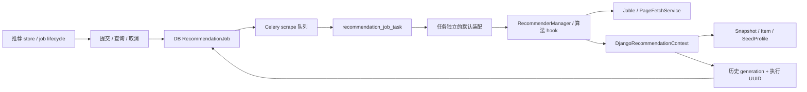

# 推荐架构与开发约束

本文维护当前实现，算法详见[推荐说明](recommendation.md)，传输字段见[接口](interface.md)，
部署与验证边界见[部署与验证边界](compose-deployment.md#近期改动与验证边界)。下载/刮削的资产控制仍由
[任务架构](task-control-architecture.md)维护，不能把推荐 job 当作下载 TaskJob。

## 状态与职责

| 模块                                                 | 职责                                                                     |
| ---------------------------------------------------- | ------------------------------------------------------------------------ |
| HTTP recommendation_job_views                        | 认证、参数上限、创建者授权与响应；不在请求中抓取                         |
| recommendation/jobs                                  | DB 条件领取、取消、预算、补派、过期收尾与成功事务 Adapter                |
| tasks.recommendation_job_task                        | Celery 运输入口；不把 Celery result 当作任务状态                         |
| composition                                          | 注入 context 与 TaskNetworkControl，构造任务独立的来源与浏览器 transport |
| recommendation/workflow                              | 准备上下文、选择策略、运行推荐与持久化能力；不依赖 Celery                |
| recommendation/base、jable_search、jable_page_lookup | 纯候选流水线、来源召回与 hook；不直接读 ORM                              |
| data_access、repository、feedback                    | 批量 ORM、snapshot 和反馈计数；短事务不含网络                            |
| frontend recommendationJob / recommendations store   | 分别管理轮询协议和当前查询/结果；API 只传输                              |

当前只有 `jable_page_lookup` 与 `local_preference`。来源 weight 控制启用，不作为多来源
排序权重；新增来源必须接入 RecommendationSource 和生产工厂，不能在通用流水线堆来源分支。
actor 映射学习通过离线脚本显式执行，默认无 Beat 注册；genre 无自动学习。
映射页有部分结果时不会为同 seed 自动搜索补齐，空结果才回退。

## 执行与提交约束

1. 创建 DB queued job 后，在事务外发布 Celery 消息。broker 失败不删除 job。
2. worker 用 queued 状态 CAS 领取，生成 execution_owner UUID；重复消息不执行。
3. 整体 deadline 为提交后 300 秒，包含排队；所有直接/浏览器 IO 使用同一控制预算。
4. 成功事务先检查历史 generation，再检查 running、执行 UUID 和 deadline。
   snapshot、item 和 job.result/state 在同一事务内提交，事务内不得加入网络或文件下载。
5. 清空历史取得共享历史 fence、递增 generation、取消所有未结束 job、删除历史。
   兼容同步推荐也必须校验准备时的 generation，禁止清空后迟到回填。
6. 反馈在读取旧反馈前取得同一历史写入 fence；禁止先读旧值再无保护地计算增减量。

取消意味着不允许后续业务提交，控制回调会在检查点协作退出。推荐无正式资产发布，
共享 HTTP/来源缓存不回滚；它不采用下载任务的 pausing/cancelling 与资产停止确认协议。
worker 进程异常后，不复用运行 token；截止时间后失败，由用户创建新 job 重试。
恢复循环不依赖浏览器或 Beat；queued 派发至少间隔 30 秒，终态 job 保留一天，历史独立保留。
关闭 TASK_RECOVERY_ENABLED 时，不承诺自动补派；查询仍可收尾过期 job。

## 来源、代理与黑名单

- Jable 未启用时明确失败。生产 strict_failures 区分合法空列表与网络、校验、解析失败，
  来源错误不能保存空成功 snapshot。
- 列表、详情和推荐封面共用 `Proxy.Enable` / `Proxy.url`，浏览器出口也使用该配置；
  Byparr 控制连接直连。`Proxy.download_url` 不参与推荐，细节见[代理路由](proxy-routing.md)。
- 控制 transport 只装入新构造的来源实例，禁止修改 SourceManager 的共享实例，
  禁止通过环境代理猜测出口。新增浏览器 provider 必须支持公开 set_task_transport 能力。
- 详情预算按尝试 AVID 计数，失败消耗预算，补候选不重置、不重复请求已尝试 AVID。
- actor/genre 黑名单启用时，只返回已核验详情的候选，允许数量不足；返回核验排除数量。
  AVID 黑名单独立过滤。新增召回路径必须经过同一最终黑名单检查。

## 前端与验证

推荐由用户手动启动，轮询只接受同 job、更高 version 的快照。失败与取消不能当作零条成功。
按钮取消先确认服务端；失败继续跟踪并允许重试。离开页面和旧提交迟到均尝试后台取消，
仅浏览器 abort 不证明后台取消；断网时服务端整体 deadline 仍负责结束。
旧 GET /recommendations 与 demo 保留同步兼容，尚无推荐 job 控制能力，生产前端不再使用。

新增能力至少覆盖：重复派发、取消与提交竞争、重置与迟到提交、超时、broker 补派、
来源失败与空列表区别、代理实际路由、共享预算、未知详情和反馈并发计数。
迁移 0026 的自动化证据来自隔离 DB，目标部署必须先 migrate 并重启 API/worker；
模拟浏览器与临时 SQLite、回环代理不等于真实来源/Byparr/Celery/PostgreSQL 验收。

## 代理并发

推荐通过公共 `ProxyServer.ordered` 并行独立 seed、热门/最新发现及详情请求，
不得面向某个浏览器 provider 写并发分支。每个操作拥有独立来源、transport 和继承
deadline 的网络控制；协调线程按输入顺序合并候选、详情和预算，保持最终 blacklist
核验与历史提交 fence。线程结束清理线程本地 DB 连接。容量由同 endpoint 的 Redis
槽位跨 worker 共享，配置与短路/失败/取消约束见[代理并发架构](proxy-concurrency.md)。

## 推荐网络预算与进度（2026-10-07）

生产 DB 推荐 job 保留提交后 300 秒硬期限（含排队），提前 30 秒停止网络工作，
给协作退出、评分和短事务提交预留时间。该软预算独立于取消、归属与硬期限；
只有软预算耗尽允许收尾，取消、失效、硬超时与来源错误不转换为部分成功。
详情按两项业务批次调度，通过公共 ProxyServer 使用实际共享容量；按已有因子预排序、
多样性重排与新鲜度优先选择候选，核验后过滤黑名单，满足目标的新鲜合格数量即可停止。
24 次详情是跨补召回共享的尝试上限，不是必须完成数量；失败尝试不返还预算。
兼容同步 GET 不使用生产 job 软预算，保持原执行范围。

运行快照新增 `progress`（其他状态为 null）：`stage`（recall/details）、
`candidate_count`、`verified_count`、`detail_attempt_count`、`elapsed_seconds`、
`network_remaining_seconds`。协调线程按执行 UUID/running/deadline 条件更新 DB JSON
与 version；进度不产生历史 snapshot，也不提供未经验证的资源或可反馈的历史 item。
`result` 仍仅在 succeeded 时可见。进度随完成批次更新，非固定心跳。

软预算耗尽且已有核验、过滤通过的资源时正常提交部分推荐；结果 meta 新增
`partial`、`completion_reason`（completed/network_budget）、`requested_count`、
`returned_count`。部分结果继续接受最终黑名单检查；即使没有演员/类别黑名单，
预算耗尽后的结果也只能包含详情核验成功的资源。没有合格结果则失败，不保存空成功历史。
数量不足但未耗尽网络预算沿用既有语义，`partial` 专指网络预算收尾。

超时日志记录 job、阶段、异常原因及 DB/网络剩余时间，用于区分硬期限和网络阶段期限；
此前提前约 27 秒失败的确切原因尚未由现有日志证明，不能宣称已定位系统时钟问题。
部署需同步更新 API 与 scrape worker；无需数据库迁移。未重新部署的服务仍使用旧契约。

## Jable 详情元数据边界

详情核验只从 `section.video-info` 提取演员、标签与类别，禁止整页扫描 taxonomy 链接：
导航菜单中的全站类别和侧栏推荐不属于当前资源。演员名优先读取 tooltip 的
`data-original-title`、`title` 或 `alt`，最后使用链接文本；头像中的单字不优先于完整名。
缺少详情元数据区域视为解析失败，不能把空演员/类别作为成功核验。
详情缓存使用 `video_detail_v2` 命名空间，隔离旧解析器污染数据；列表缓存保持原 key/TTL，
旧详情自然过期，无需全局清空 Redis。部署需同步更新 API 和 scrape worker。
`verified_count` 表示详情核验后通过黑名单的候选数，抓取成功并不保证该数增加。

## 自适应首轮召回与统计

生产 job 按演员/类别交替顺序，每次两个 seed，通过公共 ProxyServer 获取页面；
每批过滤已有资源、黑名单和近期历史后，若新鲜候选达到目标池即进入详情。
目标池为 max(limit, min(detail_enrichment_limit, 2 × limit))，默认 24；
列表整页返回可能使数量略超目标。配置的五演员/五类别仍是可用种子池，未使用的种子
保留为补充；热门/最新也延后到种子池无法提供足够候选时，不再每轮必抓全部来源。
演员与类别内部保持原偏好顺序，多样性按实际已召回候选重排；因此首轮来源覆盖会缩小。
不足时复用剩余种子和原扩展 hook，共享 AVID 去重与详情尝试预算，不重置预算。
同步兼容 GET 保留完整首轮召回方式。

进度和结果 verification_context 新增 recalled_count、detail_success_count、
blacklist_excluded_count、unverified_count、qualified_count，详情尝试数仍单独报告。
召回/成功/排除按本轮唯一 AVID 计数；黑名单包含召回和详情阶段命中，未核验只统计最终
保留候选池中尚未核验的资源，合格为最终排名前符合返回条件的数量，返回数可能更少。
已有资源与近期历史过滤可能另行减少候选，不能把 recalled_count 当作核验通过率分母。
保留旧 excluded_unverified_count、candidate_count、verified_count 的兼容语义。

## v2.4.5 前端消费者与发布边界

前端 recommendationJob 只处理提交/版本轮询/取消；store 持有当前查询，页面保存完整合并列表及偏好到既有 sessionStorage。每轮结束、pagehide 和路由卸载都保存，初始化恢复前不发新请求；失败追加不丢成功批次。详情 progress 是数量快照，result 仅成功后可见，不应把本轮计时 UI 描述为后端资源流。

useRecommendationElapsed 的单调时钟用于页面等待时长，不能替代服务端 deadline/network_remaining_seconds。推荐卡片添加通过独立 resource job_id 跟踪，授权快照确认已保存即可禁用；所属翻译失败不能将已保存资源重新开放添加。前端详细约束见[开发契约](../../vue_frontend/doc/development-contracts.md)。

从 2.4.4 升级涉及迁移 0026、API/scrape worker 与前端同步发布，所有 worker 统一代理容量配置。用户已在本轮确认推荐系统可用；该确认不扩大为独立 PostgreSQL、所有 provider 或高并发容量验收。v2.4.5 文档修订、历史隔离证据及仍待专项范围见[部署与验证边界](compose-deployment.md#近期改动与验证边界)。

## 共享原站事实缓存

生产推荐 Jable 详情与受控刮削共享独立数据库事实缓存；批量缓存读取由协调线程持有，网络 miss 仍通过 ProxyServer 能力调度。命中不复用推荐评分或业务库存判断，黑名单和反馈每轮重算。缓存发布也使用 history generation、执行 UUID 和 deadline fence，取消/重置后旧结果不能写回。迁移 0027、TTL、缓存命中/网络尝试统计和有界清理见[持久抓取缓存](resource-cache-architecture.md)。

## 第二阶段个人行为衔接

收藏和观看权重读取 `UserResourceState` 中任务创建者的行，旧共享AVResource列只留作显式导入和回退快照，不统计其他账号行为。推荐历史/反馈/黑名单已按用户隔离（见下节），仍保留单操作者准入；开放多账号须先完成[权限规划](multi-user-roadmap.md)。

## 用户归属（第三阶段）

0035为Snapshot、SeedProfile、AvidBlocklist、State增加owner；Item/ItemSeed/Feedback沿snapshot继承。HTTP、同步兼容入口、种子个人标记、近期去重、反馈计数、黑名单投影和重置均显式传user_id。Repository.for_user返回独立作用域，无user_id的兼容实例只访问NULL owner旧数据。演员/类别/来源映射、正式资源、抓取缓存及ProxyServer容量仍共享，推荐继续由Celery scrape队列执行，source/browser使用全局Proxy.url。

反馈、黑名单和重置先取本用户历史写入fence；重置只增加本用户generation、取消本用户job。worker归属由job.owner注入，缓存提交及snapshot提交同时检查个人generation、execution UUID与deadline；停用账号不能提交。网络始终在事务外。

推荐偏好存入UserPreferences JSON：recommendation_type_preference、recommendation_actor_preference、recommendation_genre_preference、recommendation_limit。缺失项只读补齐默认值，任务提交时冻结有效配置，明确传参优先。页面提供显式保存，结果sessionStorage按账号命名，登出清理；旧未归属页面缓存不恢复，迟到反馈/黑名单响应不能写入新账号store。

迁移不推断旧共享数据归属，保留NULL owner待导入，业务用户不可见。维护窗口停止API/worker/Beat并备份，迁移取消旧活动推荐job，禁止混跑旧消费者。首次个人推荐前执行`uv run python manage.py import_recommendation_data --username <原操作者>`预览，确认后加`--apply`。只允许配置中的原操作者；目标已有个人推荐数据或活动job时拒绝自动合并。条目/种子/反馈关系保持，无残余旧行时再次执行为零操作，不改共享资源、缓存或文件。

回退0035移除个人归属；不同用户已有相同AVID黑名单或种子身份时主动拒绝回退，不自动丢数据恢复旧唯一约束。必须先备份并明确处理冲突；回退移除新增用户state行，旧活动job不复活。删除账号级联清理所属个人推荐状态。仍保留is_operator准入，不开放注册或普通用户共享资产/任务控制权限。
