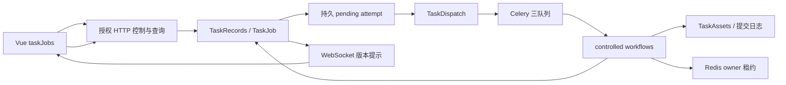

# 持久任务控制与资产提交架构

适用基线：v2.4.3，代码 `7a3d7f1`。本文维护新增下载、HTTP 刮削及所属翻译的当前架构与开发约束；历史无 job_id 的任务和同步入口继续兼容，不自动获得控制能力。字段见[接口](interface.md)、模型与迁移见[数据库](database.md)、操作步骤见[部署说明](compose-deployment.md)，证据与接受范围见[验证状态](validation-status.md)。原[设计计划](../../docs/task-pause-cancel-design.md)及 P0–P7 报告用于追溯，不替代本文。

## 状态所有者与依赖方向

| 模块                                                  | 唯一职责 / 禁止越界                                              |
| ----------------------------------------------------- | ---------------------------------------------------------------- |
| task_control_rules                                    | 无框架的状态迁移、允许动作与 ExecutionToken；不读 ORM/Redis      |
| task_models、task_records                             | 持久任务、命令幂等、执行归属、检查点、版本条件更新和恢复 fencing |
| controlled_download / scrape / translation            | 编排各用例，消费显式依赖；不反向导入 HTTP 或生产装配实例         |
| task_dispatch                                         | 从持久待派发 attempt 发布 Celery；DB 事务内不访问 broker         |
| task_assets、resource_file_locks                      | 私有文件归属、提升日志、备份/补偿、共享发布/删除锁               |
| download_resume、task_processes、task_network         | 分别负责续传验证、进程身份/停止证明、有界网络与控制回调          |
| owned_translation、task_resource_persistence / events | 资源翻译 CAS、短 ORM 保存、持久事件出箱及收件去重                |
| composition                                           | 装配默认 Adapter 和任务独立的 Source/Scraper/Translator 实例     |
| task_presentation、HTTP                               | 裁剪授权快照、校验登录/CSRF/参数；不暴露私有检查点与资产路径     |
| 前端 taskJobs / taskDetails / TaskDetailsPanel        | 分别拥有原始快照与生命周期、展示适配、筛选/选择及操作事件        |

TaskJob 是业务真相；Celery result 不决定整体完成，Redis 队列/进度是兼容投影，WebSocket 只提示刷新。资源记录拥有正式元数据及翻译归属；任务检查点拥有未提交准备结果。迁移 0022–0025 必须在目标实例按序核对，新旧消费者切换按部署文档进行。

## 任务身份、控制与停止确认

- `job_id` 是稳定业务 UUID；同 AVID 可存在不同类型及历史任务，不能用 AVID 代替列表身份。
- `TaskAttempt` 是每次执行/所属翻译派发 UUID；恢复产生新 attempt 与 generation，当前 task_id 会变化。
- `ExecutionToken(job_id, attempt_id, generation, owner)` 约束领取、心跳、阶段、结果与提交。旧消息、旧 owner 或失租执行不得改写新状态、译文、正式文件或成功副作用。
- API 写命令使用 `expected_version` 和 UUID `request_id`；重复幂等键不再次派发，同一键换动作冲突。并发冲突返回授权当前快照，批量逐项成功/失败，不回滚已成功项。
- pending 派发记录先持久化；broker 暂不可用仍可接受入队请求，后台补派，不伪造执行已开始。

| 当前状态                       | 可请求动作               | 确认语义                                                |
| ------------------------------ | ------------------------ | ------------------------------------------------------- |
| queued / running               | pause、cancel            | 有写入者先进入 pausing / cancelling；无写入者可直接确认 |
| pausing                        | cancel                   | 终止优先于暂停；此时不能恢复                            |
| paused                         | resume、cancel           | 一般可恢复，错误/待恢复日志可进一步限制 allowed_actions |
| cancelling                     | 等待确认                 | 不代表进程已经退出或文件已经清理                        |
| succeeded / failed / cancelled | 清理失败时 cleanup_retry | 业务终态不可恢复；清理重试不创建执行                    |

状态实际允许动作以服务端 `allowed_actions` 为准。暂停在检查点/网络块/CLI 回调等位置协作响应，退出写入者及下载器后代后释放槽位；暂停不冻结整个 worker，也不自动过期。paused 保留同类型 AVID 的 active_key 名额，恢复原任务。终止清理任务自有未提交产物，已保存资源、正式视频与复用头像保持；删除正式资源走独立删除流程。

`cleanup_state` 与业务 state 独立：cancelled 不证明删除已完成，权限失败可重试。`.tasks` 残留不生成任务，任务来自 DB；手动删目录不取消任务。“不再跟踪”只是当前用户在浏览器的隐藏记录。

## 刮削检查点与所属翻译

controlled_scrape 分阶段保存解析输入及私有图像资产引用，正式提交复用原 ORM 保存并登记资源事件。暂停恢复复用有效准备结果；资源已保存时不重复抓取/发布，而是继续所需翻译。仅重翻译刷新不请求来源与图片。

主 attempt 交接停止后，翻译以同一 job 的 child attempt 在 default 队列执行。TaskJob.state 包含所属翻译：资源保存后翻译仍等待/执行时整体未完成；翻译成功才完成，翻译失败整体失败但 `resource_saved=true` 保留。跳过或未请求翻译允许结束。历史 Redis 任务仍由兼容展示合成 workflow_state，不能混淆两种 state 语义。

翻译同时校验父 job token 和资源 translation_generation/owner。较新的手动/批量翻译取代旧归属时报告 TRANSLATION_SUPERSEDED，旧结果及异常收尾不触及新请求；终止仅收尾本任务所属执行。受控翻译保留旧译文直到新结果提交；旧同步重新翻译入口的兼容清空行为单独维护。

资源与 TaskEvent 出箱在受控 ORM 事务内登记，事务外派发；稳定 event_id 和 TaskEventReceipt 防止已接入消费者重复副作用。新增消费者须维护自身幂等收件，不能把普通信号发送宣称为端到端 exactly-once。

## 私有资产、发布与补偿

cover/avatar/video 根必须各自独立、不能重叠。工作区 `.tasks/<job_id>` 在恢复间稳定；TaskArtifact 只登记经过校验的归属路径，拒绝越界、链接和未知资产。TaskAssets 依次获取任务锁、资源锁及按目标排序的路径锁；发布和删除必须复用 resource_file_locks，不能另建平行锁域。

发布顺序必须保持：

1. 在短 DB fence 外校验准备资产和既有目标的哈希/指纹。
2. 持久登记 promoting 准备日志，包括旧/新 marker、旧 checksum、备份路径及本次提交身份。
3. 在 DB fence 外建立旧目标备份：优先硬链接；仅 EPERM/EACCES/EXDEV/EOPNOTSUPP 改用独立复制。复制使用排他临时文件、O_NOFOLLOW、分块控制检查和完整 checksum，完成后原子发布为有效备份。磁盘错误不静默回退。
4. 重查源/目标指纹及执行归属，在短 controlled_transaction 内提升文件、更新 TaskAssetTarget marker、执行短 ORM persist。下载可附有界 Redis owner 核查；不放网络、Celery 派发、复制、大文件哈希或成功事件。
5. DB 失败或崩溃时按日志补偿；确认旧 writer 停止后才恢复/清理。未发布且原目标未变时只移除私有备份，保留原正式 inode；已发布时按已校验备份恢复。

文件系统和 DB 没有全局原子事务，日志承担可审计补偿。marker 区分发布归属，即使后续文件字节相同也不能由旧恢复覆盖。目标变更、备份缺失或身份不明时保留现场并显式失败；未恢复的 promoting 日志阻止任务恢复及正式删除。

终态只清理本任务工作区，成功也清理私有备份；暂停保留缓存。共享 flock 文件保留以稳定 inode：`.nassav-delete-locks`、`.nassav-task-locks`、`.nassav-task-target-locks` 的锁在退出操作/进程时释放，不在线 unlink 文件。

## 下载续传边界

稳定工作区和保存名供 N_m3u8DL-RE 复用完整分片，无需新增 resume 参数。当前已验证缓存协议限于闭合、单轨 MPEG-TS VOD（包括受支持 AES）；直播、独立音轨、fMP4、byterange 等不承诺续传。初次下载可交 CLI 处理，但不支持的暂停缓存或身份变化要求 RESTART_REQUIRED，终止后重建。

恢复先读取当前播放列表、轨道与密钥，比较规范化身份，再验证已登记本地完整分片 SHA-256；缺失分片由 CLI 下载，损坏、未知和未完成缓存先删除，拒绝链接/异常路径及超限输入。不重新下载全部完整缓存。URL 查询参数不参与规范化身份；清单、轨道和密钥不变时，同 URL 服务端替换内容无法检出，最终解码也不能证明远端内容身份未变。

播放列表/密钥单次请求预算 60 秒（5 秒连接、55 秒传输），仅超时重试一次，间隔 0.5 秒；部分响应丢弃，回调保持控制检查。持续超时转 paused / RESUME_VALIDATION_TIMEOUT，保留缓存及恢复/终止能力。原生 CLI 退出零不足以提交成功：ffprobe 核对容器/轨道/时长，按需真实 MP4 转封装，并全量 ffmpeg 解码后再次检查执行归属。

## worker 恢复与运行身份

各 worker 主进程启动恢复循环，默认每 15 秒扫描；不依赖浏览器或 Beat。补偿 pending 派发、恢复停止执行的日志/清理及重试事件。心跳超时只触发核查，不证明 writer 已死。

身份包含 host、boot_id、PID namespace、PID/PGID、start_ticks 和继承到子进程的归属标记。同机可核查并有界停止确认的后代才允许收尾；跨容器身份无法核实时保持 RECOVERY_UNCONFIRMED，不猜测 PID、不清文件、不释放别人的租约。已停止但日志待恢复显示 ASSET_RECOVERY_PENDING。人工 `recover_tasks --confirm-stopped-attempt ... --all-writers-stopped` 仅在核实原实例及后代退出后使用，不对 HTTP 开放。

Compose 七个后端入口共享非 root `NASSAV_UID:NASSAV_GID`；换身份需 recreate。宿主机资源根符号链接可以用作 Docker bind 来源，但应用资产内部不允许链接。权限工具传入人工核对的真实目录；默认只读，`--repair --writers-stopped` 要求真实停止所有写入者，旧正式文件显式 `--include-published`。不改 Redis/Ollama 卷、密码文件或关闭内核 hardlink 保护。完整操作见[部署说明](compose-deployment.md#后端运行身份与任务目录权限)。

scraper/元数据/封面/头像共用全局 Proxy.url；下载使用独立 download_url / DOWNLOAD_PROXY_URL，Byparr 控制连接直连。任务请求实例不得携带其他 job 的控制上下文，代理细节见[路由说明](proxy-routing.md)。

## 前端跟踪与扩展检查清单

前端按稳定 job_id/version 合并授权快照，WebSocket 仅提示 job_id/job_type/version；重连、可见性恢复和轮询补查不依赖任务页打开。登出/卸载使旧请求失效；同 AVID 的任务可分别选择。排序由 DB 在分页前降序完成，选择和批量操作仅作用于已加载任务。网络控制结果未知时复用原 request_id；pausing/cancelling 持续等待确认。DEBUG 样例不能发送真实控制命令，详见[前端契约](../../vue_frontend/doc/development-contracts.md)。

新增阶段、任务能力、资产类型或消费者时必须核对：

- 明确状态所有者、公开能力及装配位置，沿用 token/version fencing 与服务端 allowed_actions。
- 检查阶段前后、阻塞 IO/子进程和提交前的控制响应；checkpoint 能否复用，旧代次能否拒绝。
- 覆盖暂停/终止竞争、重复派发、失租、崩溃、部分成功、清理失败及较新发布/翻译替代。
- 文件副作用纳入资产日志与共享锁，事件消费者幂等；不在短 DB 回调执行长操作。
- 同步接口、数据库、前端契约及运行说明；按[测试说明](../tests/README.md)选择隔离与 opt-in 门槛，根目录 pre-commit 必须通过。明确区分已实现、隔离验证和目标环境接受。

## 推荐任务的独立边界

推荐使用独立 `RecommendationJob`、历史 generation 和执行 UUID，不复用带资产语义的
TaskJob。Celery 在 scrape 队列执行、DB 保存结果、HTTP 授权查询和取消；
无正式资产提升，取消表示禁止提交并协作退出，不声称文件 writer 已退出。
共享网络预算/代理能力可复用，状态与补偿协议不能混用，详见[推荐架构](recommendation-architecture.md)。
