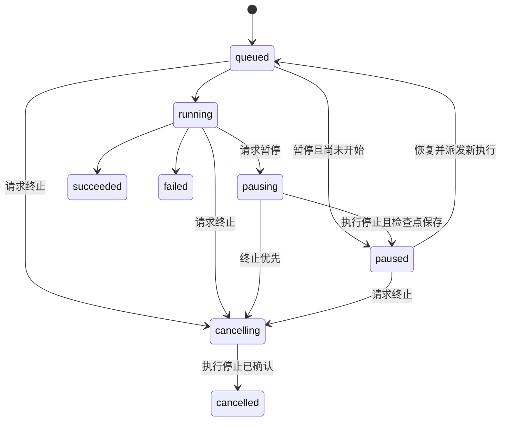

# 下载与刮削任务：暂停、恢复、终止设计与执行计划

日期：2026-10-06。设计基线：`idle` 的 `aa14a27`。P0–P4 已完成，见 [P0](task-control-p0-results.md)、[P1](task-control-p1-results.md)、[P2](task-control-p2-results.md)、[P3](task-control-p3-results.md)和 [P4](task-control-p4-results.md)。P5 的持久刮削及翻译归属见[执行记录](task-control-p5-results.md)；前端控制见 [P6 执行记录](task-control-p6-results.md)，真实 worker 联调与恢复见 [P7 执行记录](task-control-p7-results.md)，P0–P7 均已完成隔离实施及验收。本文保留最初设计和实施时的上下文（包括“建议”项），不作为当前部署状态。当前规则以[任务控制架构](../django_backend/doc/task-control-architecture.md)为准，验收范围见[验证状态](../django_backend/doc/validation-status.md)。

## 1. 目标与推荐决策

下载与刮削提供单条及批量暂停、恢复、终止；浏览器刷新或 worker 重启后能够读取真实状态。暂停保留检查点和临时产物，释放执行容量；终止禁止继续提交结果，并清理任务自有、尚未提交的产物。已提交资源的删除沿用独立删除流程。

推荐采用**持久化的协作式控制、分阶段检查点、任务专属临时目录和文件归属清单**。Celery 负责派发执行，任务业务状态由新的任务记录维护；Redis 继续承担租约、实时进度和推送加速。暂停不以冻结整个 Celery worker 实现，终止也不以杀死 Celery worker 子进程实现。

建议默认行为如下，实施时可再调整产品选择：

- 暂停不限时间，不自动变成终止；长期占用磁盘通过列表明确展示。终态历史建议保留 30 天，未完成清理的记录不能到期删除。
- 暂停后的同类型同 AVID 任务继续占用业务去重名额，恢复原任务而不是新建重复任务；不占用运行槽位。
- 终止默认删除尚未提交的封面、头像、HTML、视频分片和中间产物，保留已提交元数据、正式封面、已引用头像与原有完整视频。
- 刮削整体流程包含其关联翻译子任务。资源保存后仍可暂停或终止尚未完成的翻译，但不撤销已保存资源。
- “不再跟踪”维持浏览器本地隐藏语义，与暂停、终止和删除资源保持独立。

## 2. 当前实现与必须解决的问题

| 位置                                                                                                                                                                                                       | 已有行为                                                                                 | 对新功能的影响                                                                                             |
| ---------------------------------------------------------------------------------------------------------------------------------------------------------------------------------------------------------- | ---------------------------------------------------------------------------------------- | ---------------------------------------------------------------------------------------------------------- |
| [下载入口](../django_backend/nassav/tasks.py)、[执行用例](../django_backend/nassav/download_workflow.py)                                                                                                   | Celery 派发；执行时等待全局下载槽位；成功、失败及 finally 清理队列和进度                 | 控制检查必须覆盖派发前、等待槽位时、执行中、成功提交前和重试前；暂停不能走普通失败清理                     |
| [下载队列](../django_backend/nassav/download_queue.py)                                                                                                                                                     | 按 AVID 保存 Redis hash，24 小时 TTL；读取仅分类 PENDING/STARTED，终态被移除             | 无法承载长时间暂停、稳定任务历史及恢复次数；不能直接新增 PAUSED 字符串后沿用现有分类                       |
| [下载租约](../django_backend/nassav/download_leases.py)                                                                                                                                                    | 每次执行拥有独立 owner，原子续租、修改和释放；失租禁止成功副作用                         | 保留已有保护，另外区分用户暂停、用户终止和失租，不能把三者混为“下载失败”                                   |
| [CLI Adapter](../django_backend/nassav/m3u8downloader/N_m3u8DL_RE.py)、[下载模块](../django_backend/nassav/services.py)                                                                                    | 有失租取消回调及进程组停止；输出直接写 VIDEO_DIR，临时路径为 VIDEO_DIR/temp；结果为 bool | 需要返回明确结果原因，并把输出、合并及转换文件全部隔离到任务工作目录；现有停止能力不证明恢复时可以复用分片 |
| [刮削任务](../django_backend/nassav/scrape_jobs.py)                                                                                                                                                        | Redis 版本快照、owner 锁、阶段通知；快照 TTL 24 小时；无暂停/取消入口                    | 仅在阶段回调续租，未全面阻断迟到文件写入、DB 保存和事件发布；锁过期不能当作人工终止                        |
| [资源用例](../django_backend/nassav/resource_workflow.py)、[资产 Adapter](../django_backend/nassav/resource_adapters.py)                                                                                   | HTML、封面先写正式位置，再保存 DB，然后下载头像、提交翻译、发布事件                      | 当前终止不能安全判断哪些文件属于本任务，也不能简单回滚整个 AVID 目录                                       |
| [资源持久化](../django_backend/nassav/resource_persistence.py)                                                                                                                                             | 创建/更新资源，关联共享演员与类别                                                        | 新演员头像不等于可删除演员；资源引用与其他并发任务必须受保护                                               |
| [翻译执行](../django_backend/nassav/translation_workflow.py)、[详情装配](../django_backend/nassav/resource_job_details.py)                                                                                 | 独立 Celery 翻译按 AVID 写 DB；父刮削快照先成功，查询时再合成整体状态                    | 必须为子任务携带父任务和资源版本归属，控制父任务时传播到所属子任务，防止旧翻译覆盖新译文                   |
| [资源删除](../django_backend/nassav/resource_deletion.py)                                                                                                                                                  | 删除正式资源或 MP4，有自己的文件锁；不按任务归属删除临时分片                             | 不直接拿它做终止清理，否则可能删除原有视频/封面；正式提交与现有删除需共同遵守提交锁                        |
| [前端队列](../vue_frontend/src/features/resources/stores/downloadQueue.js)、[刮削状态](../vue_frontend/src/features/tasks/stores/scrapeJobState.js)、[任务页](../vue_frontend/src/views/DownloadsView.vue) | 下载读取队列与 WS；刮削按 token 获取快照；结束按钮目前是示意；部分终态集合仅含成功/失败  | 需要扩展状态、终态与轮询策略，处理命令接受和实际停止之间的差别                                             |

下载信息解析还有缓存缺失时调用同步新增资源的路径，见 [download_information.py](../django_backend/nassav/download_information.py)。该路径也必须接受控制上下文，或改为明确的受控准备阶段，避免终止视频下载后仍继续生成封面和头像。

当前 Compose 为 scrape/download/default 独立队列、各并发 1，资源目录共用挂载。设计先支持这一部署，以及 SQLite/PostgreSQL 两种数据库；不把单实例假设扩展成跨主机进程控制承诺。

## 3. 状态与控制语义

### 3.1 整体状态

统一使用 `queued`、`running`、`pausing`、`paused`、`cancelling`、`cancelled`、`succeeded`、`failed`。`stage` 独立记录来源查询、元数据、封面、头像、保存、视频下载、合并和翻译等阶段。

`succeeded`、`failed`、`cancelled` 是终态；恢复仅针对 `paused`。失败后的重试另建任务，不隐式恢复终态任务。重复暂停/终止返回当前状态，重复恢复不得再次派发；终态的终止请求返回明确冲突，并提供当前快照。暂停处理中暂不接受恢复，避免新旧执行交错。

命令持久化后通常返回 202，表示已接受。前端直到 worker 确认停止才显示“已暂停/已终止”，不能收到 HTTP 成功就假定文件不再写入。若命令与提交竞争，以原子提交门槛的先后次序决定结果：提交先获准则对应已提交内容保留，控制先获准则禁止该内容发布。

### 3.2 执行停止与清理分别展示

增加 `cleanup_state = not_required | pending | running | completed | failed`，以及待清理数量、失败原因与可重试标志。`cancelled` 表示执行已确认停止，不表示磁盘清理全部成功；例如“已终止 · 清理失败”仍需可见，不能被普通批量隐藏已结束任务误清除。

若停止未确认、进程身份不明或 worker 心跳丢失，保持 `cancelling` 并展示恢复处理中/停止未确认。不能仅因为 Redis 租约过期就删除可能仍有 writer 的目录。恢复模块确认执行已结束后再进入 `cancelled` 和清理。

“已结束”扩展为成功、失败和终止；“已暂停”不在其中。暂停/终止请求记录时间与实际确认时间分别进入活动时间线。

## 4. 状态所有者与模块设计

### 4.1 持久化模型

建议新增三类数据，不把新的持久状态继续寄托于 Celery result 或浏览器 localStorage：

| 数据         | 最小内容与职责                                                                                                                                  |
| ------------ | ----------------------------------------------------------------------------------------------------------------------------------------------- |
| TaskJob      | 稳定 job_id、类型、AVID、add/refresh 操作、操作人、输入选项、整体状态、期望动作、stage、version、checkpoint、关联资源、错误、时间线、清理汇总   |
| TaskAttempt  | 每次派发的 Celery task_id、job_id、generation、main/translation 角色、owner、心跳、开始/退出状态；恢复创建新 attempt，job_id 不变               |
| TaskArtifact | job_id、工作区相对路径、类型、大小/校验信息、staged/promoting/committed/deleting/deleted 状态、正式目标、归属及提交记录；支撑崩溃恢复和清理重试 |

TaskJob 是任务状态的唯一所有者。Redis 保存缓存/控制提示和租约；缓存失效后从 DB 恢复。API 命令及实际状态变更使用版本条件更新或等价事务，必须在 SQLite 与 PostgreSQL 上均验证，不能只依赖 SQLite 不支持的行锁效果。

逻辑去重通过 DB 唯一活动键约束同类型同 AVID 的未结束任务，含暂停；执行租约仅在实际执行时存在。恢复从 DB 原子获取新 generation，旧 attempt 不能继续运行、写状态或提交结果。最终路径的资源级短锁协调下载提交、刮削刷新和现有删除入口；提交前同时检查任务状态、执行 owner 和资源版本。

### 4.2 深模块及 Interface

对调用者公开少量能力：`request(job_id, action, expected_version)`、`get(job_id)`、执行侧 `checkpoint(stage, payload)` 和 `commit(...)`。Interface 同时规定幂等、版本冲突、停止确认与文件保留语义，复杂的锁、重试、子任务和清理留在 Implementation 内。

- 任务控制 Module：验证迁移、记录命令和控制子任务；HTTP 只处理身份、输入和响应。
- 任务记录 Adapter：DB 状态、版本及归属检查；Redis Adapter 维护执行租约、进度缓存及 WS 提示。
- 执行控制 Interface：工作流在检查点获知继续/暂停/终止/失租；CLI Adapter 和网络阶段的 Adapter 采取各自的停止方式。
- 任务资产 Module：工作区、清单、提交与清理，对外不暴露遍历共享目录删除的能力。
- DownloadUseCase / ResourceService / 翻译用例：保留编排职责，注入控制和资产能力；默认实现由 composition 装配。

不修改 `RedisJobStore` 的通用终态保护去迁就暂停，因为外部搜索仍复用它。新任务记录独立接入下载/刮削，已有外部搜索继续沿用现有取消协议。

### 4.3 派发与失效消息

先创建 job/attempt 与待派发标记，再向 Celery 发布。使用事务提交后派发加可重试的派发记录：修复“DB 已提交但消息未发布”，并以 attempt 原子领取消除重复发布影响。重派发可重复投递，执行只能领取一次。

已排队任务暂停时，业务记录立即转为 paused，旧 attempt 失效；运行中暂停则先进入 pausing。`revoke(terminate=False)` 只作为减少旧消息消费的补充。恢复必须生成新的 Celery task_id，不能复用已 revoke 的 ID。所有任务入口在开始前验证业务状态和 attempt，不依赖 inspector 判断真相。

控制请求在 DB 落地后即有效；Redis 控制提示失败仍由执行侧在检查点回读 DB。Redis/DB 故障时执行不得越过无法确认归属的提交门槛，保留临时文件并报告控制状态未知，不能伪造用户终止。

## 5. 暂停与恢复机制

### 5.1 下载

推荐“停止本次 CLI 执行、保留工作区、恢复时重新派发”。暂停确认前 CLI 及 ffmpeg/解密等后代进程必须全部退出，保存检查点，再释放全局下载槽位和执行租约。之后其他视频可以下载。

不使用 SIGSTOP/SIGCONT 作为产品暂停：它保留进程和占用容量，网络请求、租约和 Celery 超时的生命周期也没有得到解决。现有进程组终止逻辑可复用，但必须返回 `paused/cancelled/lease_lost/failed/completed` 等明确原因，不能把人工操作映射成 bool 失败并触发自动重试。

下载分片复用是首个验证门槛。当前固定 N_m3u8DL-RE v0.5.1-beta 的参数文档提供 tmp/save 路径控制，未提供可直接据以承诺本方案的暂停恢复契约。P0 必须用固定二进制和本地 HLS 服务验证：停止方式对分片完整性的影响、重启是否跳过有效分片、合并中断后是否可恢复、URL 更新后是否仍可安全复用。[上游参数说明](https://github.com/nilaoda/N_m3u8DL-RE/blob/v0.5.1-beta/README.md#命令行参数)。

只有验证通过才展示“保留分片并续传”。记录播放列表/轨道/分片身份与校验信息，不能只依据文件名或文件存在来复用。URL 过期时受控重新获取；内容身份变化则暂停并提示需重新下载，不静默拼接不同内容。CLI 不支持可靠分片复用时，暂停仍可停止并保留工作区，但恢复需要从当前下载阶段重新开始；这一降级须报告证据并由用户决定是否接受或更换下载实现。

解析来源信息、等待槽位、下载、合并、格式处理和正式提交均检查控制。下载百分比与可恢复检查点分别记录，前端不将“停止前 60%”视为恢复后必然从 60% 网络传输继续。

### 5.2 刮削

按来源获取、元数据、封面、逐个头像、资源提交、翻译建立检查点。保存已完成阶段的解析结果、选用来源、选项和资产清单；恢复从未完成阶段继续，不重复已提交资源，也不重新发布已完成事件。

网络阶段在请求前后、重试间、来源切换间、头像之间以及文件写入分块处检查控制。已发出的不可中断 HTTP/Byparr/Ollama 请求可等待其配置超时，但返回结果后不得继续写正式文件或发布成功结果。阶段仅在可安全保存检查点后变为 paused。

当前网络配置有不同超时和重试，ScraperManager 的 3600 秒是缓存 TTL，不是网络请求期限。P0/P4 须审查并缩短为可控的请求期限、重试预算及总阶段期限；未测量前不承诺“刮削 1 秒内停止”。前端明确展示“暂停中/终止中，等待当前请求结束”。若目标要求即时中断，需要额外的可取消传输或任务专属隔离执行器，不靠强杀共享 worker 实现。

### 5.3 翻译子任务

保存资源不再自动意味着整个可控制刮削 job 已结束。整体 job 在翻译未完成时保持 running，并标明 metadata 已提交；等待子任务不占用主刮削 worker。原始资源保存状态继续保留兼容字段。

翻译 attempt 携带 parent job_id、generation 和资源翻译版本。执行前、写入 translating 前、返回结果后及异常收尾前校验归属。暂停/终止只作用于该父任务的翻译，不取消其他手动或批量翻译。

正在调用的翻译无法在 HTTP 中途挂起时，在返回后丢弃不再属于当前执行的结果；暂停不把该结果写回正式资源。恢复重新提交同一检查点的翻译。已成功提交的译文保留；手动重翻译或刷新使旧执行版本失效，旧成功和旧异常收尾都不得覆盖新译文/状态。资源级 translation_status 与任务的控制状态分离，取消不得伪装成翻译失败。

## 6. 终止后的文件清理与提交规则

### 6.1 工作区和归属

分别在 COVER_DIR、AVATAR_DIR、VIDEO_DIR 所在文件系统下建立 `.tasks/<job_id>/`，保证最终提升操作可在同一文件系统完成。视频包含 tmp、输出、合并/转换及 CLI 元数据等；头像以稳定 actor 标识记录归属，源名称不能直接作为任意路径组件。检查点和清单持久化于 DB。

先登记预计写入路径，再创建文件；崩溃时可依据清单和经过校验的任务私有目录补充清理。路径必须规范化并限制在配置根内，不跟随符号链接；浏览器不能提交待删除路径。正式文件名和现有读取 URL 保持兼容。

正式视频在检查完整性并通过提交门槛后才提升到 `<AVID>.mp4`。不能把现有 `ensure_mp4` 的重命名当作格式/完整性验证。封面/头像也先验证图像，再提交。

### 6.2 默认清理表

| 产物                                         | 暂停                               | 终止                                             |
| -------------------------------------------- | ---------------------------------- | ------------------------------------------------ |
| 本任务未提交 HTML、封面及临时缩略图          | 保留并记录完成情况                 | 删除私有副本；不删既有正式封面或缩略图           |
| 本任务下载的新头像，尚未发布                 | 保留                               | 删除本任务私有副本，无需删除演员 DB 记录         |
| 既有头像或已正式提交且被资源/演员引用的头像  | 保留                               | 保留，即使最初由本任务下载                       |
| 其他任务准备使用的头像                       | 保留                               | 只能删本任务的私有副本，不能清共享正式文件       |
| 视频分片、未完成视频、合并/解密/转换中间文件 | 保留有效产物，损坏分片标记不可复用 | writer 确认退出后删除本任务工作区内产物          |
| 下载开始前已存在的完整视频                   | 保留                               | 保留，终止不能退化为 delete_video                |
| 已经过提交门槛的本次新视频                   | 保留                               | 保留，作为已提交结果；后续删除用正式视频删除入口 |
| 已保存元数据、新建演员/类别及关系            | 保留                               | 保留已提交内容；不全局清理“孤立演员”             |
| 尚未提交的刷新结果                           | 保留私有结果                       | 删除暂存结果，原有资源/封面/译文维持原状         |

资源提交前暂存 HTML、封面和本次头像结果，再统一进入提交协议；这会改变当前“封面先正式落盘、DB 后保存、头像最后下载”的副作用顺序，必须作为显式行为变更测试，不能归为纯结构重构。头像/封面可选失败的已有业务语义继续明确表达，不擅自把所有图片失败改为整个资源失败。

共享头像提交时检查现存文件与引用，第一版优先复用已有有效头像，不自动覆盖。确需替换时作为独立更新行为，在演员级短锁内提交新版本。资源终止不承担已提交共享头像的垃圾回收。

### 6.3 提交竞争与崩溃恢复

DB 与文件系统没有统一事务。提交以短临界区和持久提交日志协调：记录 preparing/promoting 状态与目标归属，检验控制和版本，进行文件提升及 ORM 保存，记录 committed，再发布事件。终止到达临界区时等待明确的提交结果；已经进入提交协议的步骤由恢复模块收尾或回退，不能任意删除。

刷新覆盖正式文件前保留可恢复旧副本；恢复模块根据日志、文件校验与资源版本决定完成提交或恢复旧值，不盲目回滚后来任务已提交的内容。事件记录需与 DB 提交一起登记，重试发布带稳定 event_id，消费端去重，防止恢复后重复成功副作用。提交失败时显示具体失败阶段及清理状态，不把文件和 DB 宣称为全局原子操作。

终止主流程：持久化取消意图 → 失效旧 attempt/阻断提交 → 执行器退出确认 → owner 检查释放槽位 → cancelled → 按清单清理 → 更新清理汇总。清理必须幂等，失败可重试；人工失败重试也不能恢复已经 cancelled 的执行。

新同类型任务可在旧任务停止后创建，但其工作区独立。旧清理不得接触新的工作区或正式文件。既有资源删除入口需与提交协调：有运行/暂停任务时默认返回冲突，提示先终止；禁止删除后旧下载或刮削重新写回资源。

### 6.4 运维与一致性

后台恢复模块扫描待派发、失去心跳、提交中和清理失败记录。基于持久记录和执行身份恢复，不依赖浏览器打开，也不仅依赖可选的 Compose beat profile；至少由运行中的任务 worker 提供定期扫描并有管理命令兜底。

同主机执行登记 worker 身份、容器/启动实例、进程组及进程启动标识；清理或本地停止需验证身份，不能按过期 PID 发信号。心跳过期只触发核查，不证明进程已死亡。worker 重启场景需要验证后代进程退出或由所属容器内恢复模块安全收尾；身份无法验证则停止自动清理并给出可操作的错误。

视频/封面/头像一致性检查、备份、缩略图与目录扫描必须排除 `.tasks`，避免临时文件被当作正式资源或孤儿清理。暂停产物不自动过期删除；提供占用统计，终止是第一版释放空间的明确入口。后续如增加“保留分片后终止”，须补充保留期限、磁盘配额及独立清理交互，不在本轮默认启用。

## 7. HTTP、推送与前端

建议新增统一任务 Interface，以下为草案：

| 入口                                          | 语义                                                                  |
| --------------------------------------------- | --------------------------------------------------------------------- |
| `GET /api/tasks/jobs`                         | 筛选/分页读取已授权任务，包括暂停和终态历史                           |
| `GET /api/tasks/jobs/{job_id}`                | 任务状态、stage、version、checkpoint 摘要、时间线、允许操作及清理汇总 |
| `POST /api/tasks/jobs/{job_id}/pause`         | 暂停请求，携带 expected_version 和 request_id                         |
| `POST /api/tasks/jobs/{job_id}/resume`        | 恢复请求，原子创建新 attempt；返回 job 快照                           |
| `POST /api/tasks/jobs/{job_id}/cancel`        | 终止请求，默认清理未提交产物                                          |
| `POST /api/tasks/jobs/{job_id}/cleanup/retry` | 仅重试已停止任务的失败清理，不恢复执行                                |
| `POST /api/tasks/jobs/actions`                | 有上限的批量动作；逐任务鉴权、版本验证和返回结果，不承诺整批事务      |

控制入口使用现有登录、操作者权限和 CSRF。现有签名 token 是读快照能力，不能自动升级为写权限；新任务记录绑定操作人，兼容历史 token 的读取方式。未登录/无权限、版本冲突、无法控制的旧任务均返回明确结果。批量请求使用相同 request_id 实现可重试，返回 accepted、unchanged、conflict、forbidden、failed 的逐项结果。

现有下载/刮削提交 URL、Celery 任务名保留；响应增加稳定 job_id，原 task_id 对应本次 attempt 并保留兼容字段。旧只读快照、队列接口由投影兼容，不让新 paused 任务被旧 active/pending 分类漏掉。迁移新前端后任务页读取持久任务列表，原全局下载状态投影仍只表示实际运行/等待下载的资源。

WebSocket 只发送 job_id、type、version 与事件摘要，前端鉴权获取快照。命令响应、WS 和轮询均按 job_id/version 合并，旧 attempt 的结果不可覆盖 paused/cancelled。暂停后降低轮询频率或由 WS 唤醒；pausing/cancelling 和清理未完成时继续跟踪，断线重连补取快照。后端推送失败不影响已落地命令。

任务页新增暂停/恢复操作和批量入口，现有叉号终止按钮接入真实命令；保持当前列表与详情布局。“结束所选任务”确认框说明：删除未提交文件，保留已保存资源和共享头像。逐项显示批量失败，操作期间禁用重复提交；筛选增加暂停、终止，详情显示停止确认和清理状态/占用，不默认把终止任务隐藏。

## 8. 分阶段执行计划

沿用 `/tmp/nassav-agent-worktree` 独立阶段分支，通过门槛后提交并合并 idle，结束保持干净 idle。每阶段只启用已具备执行保障的操作，不能先上线按钮再补后台控制。

| 阶段 / 建议分支                          | 工作与交付                                                                                                                     | 进入下一阶段的门槛                                                                                     |
| ---------------------------------------- | ------------------------------------------------------------------------------------------------------------------------------ | ------------------------------------------------------------------------------------------------------ |
| P0 `spike/task-stop-resume-capabilities` | 固定 CLI 二进制与本地 HLS 样例；验证分片复用、合并中断、URL 变化；测量网络停止延迟、进程树退出和现有扫描行为，记录推荐恢复模式 | 无遗留 writer；复用内容经校验且可测；不满足则先报告证据，决定降级或更换下载实现                        |
| P1 `feat/task-control-records`           | TaskJob/Attempt/Artifact 模型与迁移；状态机、版本控制、活动键去重、派发重试、快照和命令；兼容旧入口，功能暂不向 UI 开放        | SQLite/PostgreSQL 的并发命令、重复派发、消息失效、权限和崩溃重派验证；暂停超过旧 TTL 后仍可读取        |
| P2 `feat/task-artifact-workspaces`       | 工作区、清单、完整性检查、提交日志、清理重试；正式删除与扫描协调；调整资源暂存顺序                                             | 新旧文件隔离、共享头像保护、路径/符号链接保护；DB/文件部分提交及权限失败可恢复，临时产物不进入资源列表 |
| P3 `feat/download-pause-cancel`          | 下载控制接入 CLI、解析、等待槽位、合并及提交；明确执行结果；暂停释放容量、恢复新 attempt                                       | 排队/运行/合并/完成竞争全部通过；后代进程退出；暂停后第二任务能运行；终止不误删已有完整视频            |
| P4 `feat/scrape-pause-cancel`            | 来源、抓取、图片、保存检查点；有界请求/重试；可恢复 add/refresh 和事件去重                                                     | 每阶段暂停/恢复/终止；刷新保留旧资源；失租、旧响应和文件写入迟到不发布；已提交资源不被误回滚           |
| P5 `feat/scrape-translation-control`     | 父子归属、翻译版本和控制传播；统一整体终态；资源翻译状态与控制状态分离                                                         | 排队/执行翻译终止、暂停恢复；新手动/批量翻译不受误伤；旧成功及旧异常收尾不得覆盖新结果                 |
| P6 `feat/task-control-ui`                | 统一快照接入、单条/批量操作、清理展示、状态筛选、活动时间线、DEBUG 模拟与无障碍交互                                            | 前端单元、构建和浏览器验收；版本乱序、断线重连、部分批量失败、刷新恢复及深浅主题/移动端通过            |
| P7 `chore/task-control-acceptance`       | 真实 worker + 临时 Redis + 隔离 DB + 本地网络 fixture 联调；重启/断网/磁盘错误验收；完善迁移和回滚说明                         | 所有质量门槛通过，任务无泄漏、产物无误删；明确目标环境待验项和上线步骤                                 |

P1 可先提供内部可测试 Interface，生产控制能力逐阶段开放；在 P5 前不得对用户宣称“整条刮削含翻译均可终止”。P0 的能力探针可保留为测试/文档，临时视频与运行服务在验收后清理。

各实现阶段执行根目录 `pre-commit run -a`；后端执行 `cd django_backend && uv run pytest tests/ --ds=django_project.refactoring_test_settings -v`；前端执行 `cd vue_frontend && pnpm run check`，涉及交互追加浏览器检查。P7 必须使用非 eager 的真实 Celery worker 验证消息、进程与文件行为；模拟 API、假进程和临时 DB 测试分别标注范围。质量门槛失败先修复；无法达成时暂停该阶段合并并与用户沟通。

## 9. 测试、迁移及文档清单

- 命令竞争：pause/resume/cancel、重复 request_id、恢复重复点击、取消先于成功/成功先于取消、终态不可复活、旧 owner 不删新锁。
- 资源归属：已有封面/视频/头像；两任务同演员；刷新覆盖；取消在 DB 保存前后；新任务创建后旧清理重试；路径穿越、符号链接与大小写 AVID。
- 执行生命周期：等待槽位期间控制；无 stdout 的 CLI；子进程存活；worker 重启；Redis/DB 故障；长 HTTP、重试和翻译返回后的写入阻断。
- 文件恢复：视频分片、合并/格式处理输出、图片半文件；权限不足/磁盘满；提升后 DB 失败；DB 保存后日志/推送失败；一致性扫描和备份跳过工作区。
- 兼容：现有 URL/任务名、同步新增/刷新消费者、外部搜索取消协议、元数据标题和翻译部分成功语义、SQLite/PostgreSQL 运行模式。

迁移前停止旧版本 worker 并排空旧任务，使用测试环境备份验证迁移。旧活动任务没有可靠资产归属清单，不能追溯推断后直接清理；第一版将其标记为 legacy，只读展示/继续原行为，要求排空后使用新任务。不得让旧 worker 接收携带新上下文的消息。回滚前先停止新派发、终止或处理新活动任务并完成清理；存在 paused 工作区或未完成提交时不能直接回滚到不识别新模型的 worker。生产迁移及破坏性清理不是本文的执行授权。

实施阶段同步更新 interface、database、p5-domain-boundaries、configuration-contract、Compose 部署和 validation-status，以及前端 development-contracts/task-details-demo 与测试说明。新默认配置需给出控制轮询、停止期限、恢复扫描、历史保留及工作区路径的实际值和验证证据。

## 10. 外部依据与本轮验证范围

[Celery workers 官方说明](https://docs.celeryq.dev/en/stable/userguide/workers.html#revoke-revoking-tasks)指出 revoke 默认不终止运行中的执行；terminate 杀的是 worker 执行进程，可能已开始处理另一个任务，因此不应由产品控制程序调用。本方案仅对任务专属下载 CLI 进程组执行停止，运行中刮削/翻译使用协作检查和有界请求。

N_m3u8DL-RE 的暂停恢复结论仍待 P0 测量，不能用 CLI 参数表或当前 cancelled 回调代替实测。本轮已核对上述仓库源码与现有部署定义，未启动真实下载、刮削、翻译或删除资源；文档质量检查记录随提交交付。
