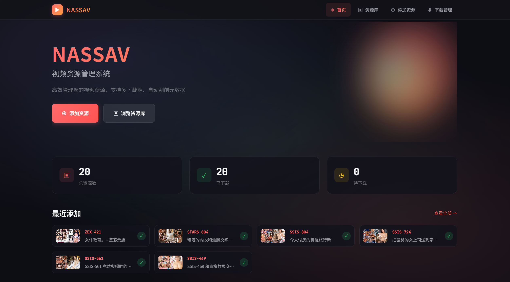
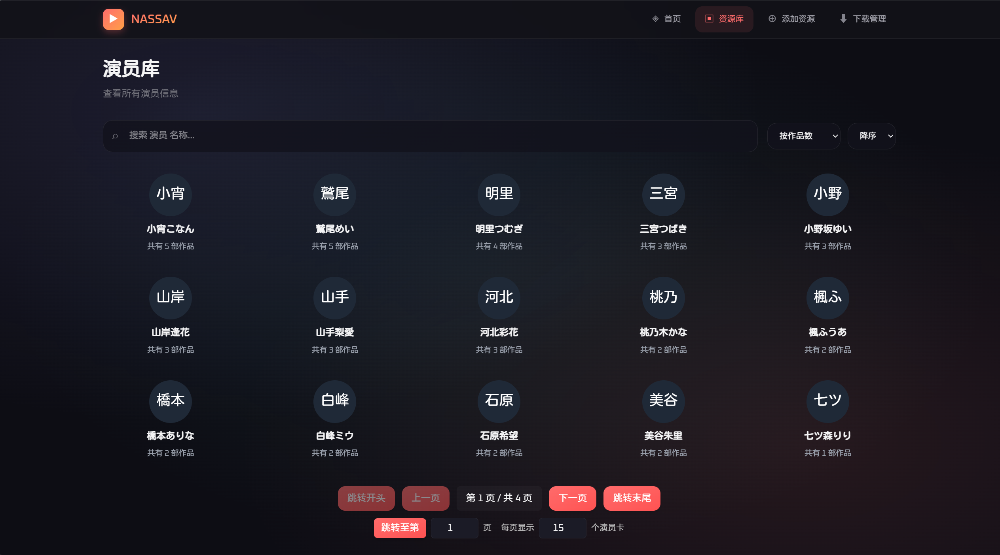
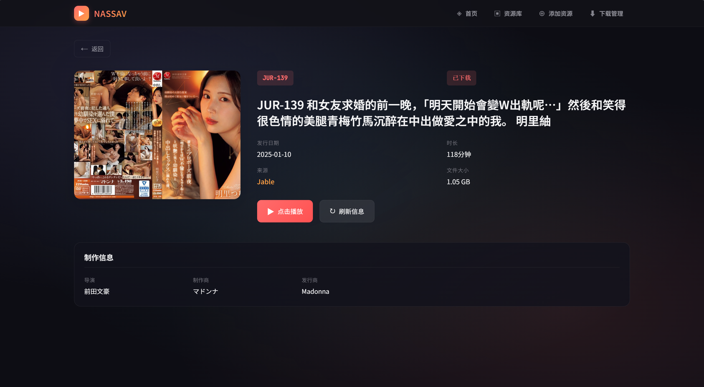
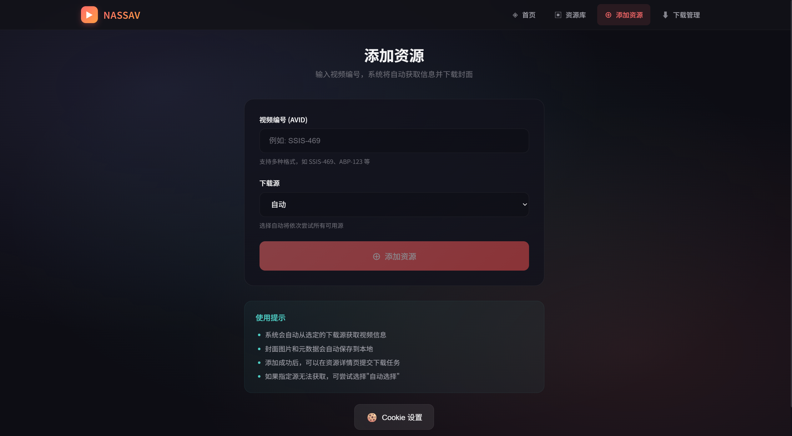
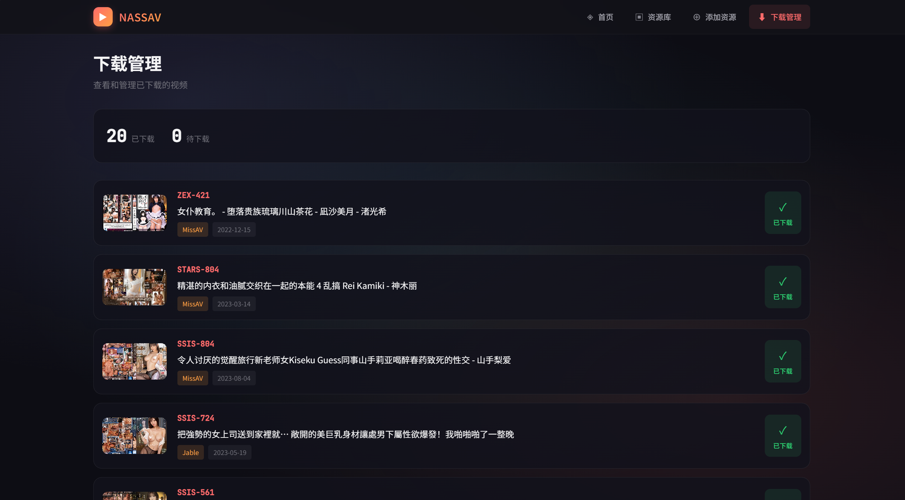

# NASSAV 前端（Vue 3 + Vite）

一个用于管理视频资源的前端应用，包含资源检索、信息刮削、任务详情等功能。基于 Vue 3、Vite、Pinia 与 Vue Router 构建，默认通过
`/nassav` 代理与后端交互。

全栈容器部署通过仓库根目录 `compose.yaml` 提供 nginx 网关，详见 [Compose 部署说明](../django_backend/doc/compose-deployment.md)。

后续开发遵循[重构原则](../docs/development-principles.md)、[前端开发契约](doc/development-contracts.md)及 [AGENT.md](AGENT.md)；阶段验证证据见[语义重构记录](doc/semantic-refactoring-progress.md)和[UX 改进记录](doc/ux-neutral-progress.md)。

## 功能概览（含页面与预览图）

当前版本为 2.4.4。以下预览图为历史页面参考，当前布局与交互以功能描述及开发契约为准。

- 首页（品牌与功能入口）
  - 功能：展示品牌、下载与刮削能力介绍，提供添加资源和浏览资源库快捷入口；品牌标识与导航共用橙色渐变，背景使用彩色柔光。
  - 路由：`/`
  - 预览：

    

- 资源库（搜索/过滤/排序/批量操作）
  - 功能：支持按
    AVID/标题/来源搜索；按状态（已下载/未下载）过滤；按日期/编号/来源排序；批量操作（下载、刷新、删除）；支持按演员、类别分类浏览；卡片操作（下载、刷新、删除资源、删除视频文件）；一键刷新列表悬浮按钮。
  - 路由：`/resources`
  - 预览：

    

- 演员库（按演员聚合浏览）
  - 功能：展示所有演员及其作品数；支持搜索演员名称；按作品数或名称排序；分页浏览；点击演员卡片查看该演员的所有作品。
  - 路由：`/resources/actors`
  - 预览：

    

- 类别库（按类别聚合浏览）
  - 功能：展示所有类别及其作品数；支持搜索类别名称；按作品数或名称排序；分页浏览；点击类别卡片查看该类别的所有作品。
  - 路由：`/resources/genres`
  - 预览：（与演员库界面类似，采用统一的卡片设计）

- 演员详情（特定演员的作品列表）
  - 功能：展示该演员的所有作品；支持搜索、排序、过滤；支持批量操作。
  - 路由：`/actors/:actorId`

- 类别详情（特定类别的作品列表）
  - 功能：展示该类别的所有作品；支持搜索、排序、过滤；支持批量操作。
  - 路由：`/genres/:genreId`

- 资源详情（元数据与操作）
  - 功能：展示封面、标题、发行日期、时长、来源、文件大小、演员、类别等；提交下载、复制本地文件路径用于播放、刷新元信息。
  - 路由：`/resource/:avid`
  - 预览：

    

- 添加资源（支持选择下载源与 Cookie 设置）
  - 功能：输入 AVID 并选择下载源（或自动），提交后回显封面下载/元数据保存/信息刮削状态；支持继续添加/查看详情；提供 Cookie
    设置弹窗（用于部分源需要认证）。
  - 路由：`/add`
  - 预览：

    

- 任务详情（持久下载与刮削任务，兼容历史队列）
  - 功能：列表/详情、类型和整体状态筛选、创建/更新时间降序、资源名称与封面、包含翻译的活动时间线；支持单条/批量暂停、恢复、终止和本浏览器隐藏已结束任务。控制能力由服务器快照决定，清理状态独立展示；顶部区分当前跟踪、已加载隐藏数与服务端总数，本地隐藏不改变后台任务。
  - 路由：`/downloads`
  - 预览：

    

- 推荐页
  - 路由：`/recommendations`；请求当前默认推荐器，支持偏好调整、推荐反馈、种子/资源屏蔽及加入资源库。
- 设置页
  - 路由：`/settings`；管理用户设置与默认外部搜索源；Cookie 设置由添加资源页按钮打开。

## 登录与外部搜索

应用使用单用户 Django 会话；未登录时展示登录界面，写请求携带 CSRF token，会话失效后回到登录流程。API 与 WebSocket 使用同源网关；DEBUG 不能绕过登录。权限和部署配置见[接口文档](../django_backend/doc/interface.md)。

演员/类别详情提供手动搜索入口；开始搜索与来源设置按钮在空白区域居中，来源由设置弹窗选择，重新搜索位于结果分页下方，不自动发起外部抓取。可用来源和排序以后端 search-capabilities 为准，当前支持启用的 Jable/MissAV；默认选择取持久化设置，不可用时回退到支持该搜索的源。MissAV 缺少映射时可能是关键词结果，页面明确提示，不能保证全部属于该演员/类别。

搜索使用后台任务，逐页展示 partial 结果；失败或取消保留已有结果并显示状态，不伪装成完整成功。用户可以取消任务；切源或离开页面终止旧请求/订阅，后台任务仍可能继续，过期响应不得覆盖新状态。WebSocket 通知触发带 token 的版本快照查询，1.5 秒轮询补偿断线。结果默认每页 15 项，翻页通过同一签名任务读取，不新建搜索；源站抓取进度与界面展示页数分别标注。添加结果时携带对应来源；部分结果不进入成功会话缓存。详细接口见[外部搜索契约](../django_backend/doc/interface.md)。

## 技术栈

- Vue 3、Vite 5（`@vitejs/plugin-vue`）
- 状态管理：Pinia
- 路由：Vue Router
- 网络请求：Axios

## 本地开发

> 要求 Node.js ≥ 18（Vite 5）。项目固定 pnpm 10.30.1（见 package.json 的 packageManager），使用与仓库配置兼容的 Node.js。

1. 安装依赖

```bash
pnpm install
```

1. 启动开发服务器（默认仅监听 `127.0.0.1:9780`）

```bash
pnpm dev
```

- 开发代理：`/nassav/api/` 与 `/nassav/ws/` 默认转发到 `http://127.0.0.1:9790`。后端不在该地址时，在启动 Vite 前设置 `NASSAV_VITE_BACKEND_URL=http://后端主机:端口`。这是 Vite 服务端连接地址；浏览器仍使用页面的 Host、Cookie 和 Origin。
- 仅在可信局域网跨设备调试时使用 `NASSAV_VITE_HOST=0.0.0.0 pnpm dev`，然后从另一设备打开 `http://开发机局域网地址:9780`。后端 `ALLOWED_HOSTS` 须包含浏览器访问的主机名或 IP；若要在该入口登录，还须将 `http://开发机局域网地址:9780` 加入 `CSRF_TRUSTED_ORIGINS`。不要将开发服务器直接暴露到公网。

1. 生产构建与本地预览

```bash
pnpm build
pnpm preview
```

- 构建产物输出目录：`dist/`

## 部署说明

前端生产部署需要 HTML5 History 路由回退，以及 `/nassav/api/` 和 `/nassav/ws/` 的同源代理。登录、CSRF、HTTPS/WSS、Host 和 WebSocket Upgrade 的完整网关要求见[Compose 部署说明](../django_backend/doc/compose-deployment.md#服务和代理)。纯静态托管若无法代理 WebSocket，需另配同源网关。

## 配置与约定

- 开发代理与别名：见 [vite.config.js](vite.config.js)
  - `server.host = 127.0.0.1`、`server.port = 9780`；`NASSAV_VITE_HOST` 可调整监听地址
  - `server.proxy['/nassav/api']` 和 `server.proxy['/nassav/ws']` → `NASSAV_VITE_BACKEND_URL`（默认 `127.0.0.1:9790`）；WebSocket 随目标协议选择 ws/wss
  - `resolve.alias['@'] = '/src'`
- 主要代码结构：
  - 视图：`src/views/`（首页、资源库、演员/类别详情、添加、下载、推荐、设置）
  - 业务模块：`src/features/`（resources、catalog、external-search、tasks、recommendations、cookies、settings、auth；组件与状态就近放置）
  - 公共能力：`src/shared/`（ui、composables、lib、stores，无业务依赖）
  - 应用装配：`src/app/`（路由、导航、WebSocket 连接）
  - 接口封装：`src/api/`（client.js 唯一客户端，按领域分文件，index.js 保留公开导出）

目录规则与状态所有者见[模块布局](doc/module-layout.md)，本轮证据见[语义与模块重构记录](doc/semantic-refactoring-progress.md)。

## 常见问题（FAQ）

- 生产环境 404（刷新页面丢失）
  - 需配置 SPA 回退到 `index.html`（见上方 Nginx 配置）。
- 接口 404 或跨域
  - 确认生产反向代理 `/nassav` 指向正确后端；并检查 Host、CSRF_TRUSTED_ORIGINS 和 WebSocket Upgrade。
- 端口冲突（开发）
  - 修改 [vite.config.js](vite.config.js) 中的 `server.port`，或释放 9780 端口。

## 异步资源任务反馈

资源添加、刷新和批量添加/刷新现在提交到后端 `/nassav/api/resource/jobs`，HTTP 202 仅表示入队。资源任务通过全局 toast 提示入队、开始、成功和失败；同一状态的阶段更新和重复 WebSocket 事件不会重复通知。WebSocket 状态事件触发带令牌的快照查询，只有快照确认 `succeeded` 后才提示成功并刷新资源数据。任务 ID 与查询令牌保存在浏览器本地存储，页面刷新或 WebSocket 重连后会重新查询未结束任务；定时查询作为断线时的补偿。重新提交失败任务会以新的任务 ID 提示“重试任务已排队”。批量删除和视频删除继续使用原接口。后端需另启监听 `scrape` 队列的 Celery worker；只启动默认 worker 无法处理资源任务。

前端无交互检查入口：

```bash
pnpm run check
```

该命令依次运行 lint、`pnpm run test` 和构建。测试覆盖资源任务从入队到终态的快照补齐、WebSocket URL、重连与会话失效，以及 Vite 的 HTTP/WebSocket 同源代理。WebSocket 连接失败时，下载页改用 API 轮询；资源任务继续通过带令牌的状态查询补齐终态。浏览器握手失败若只返回异常关闭码，前端会查询 HTTP 会话：登录已过期则停止重连，网络故障则继续重试。

## 公共组件浏览器验收

`tests/browser/components.cjs` 使用 Playwright 在独立页面挂载真实 Vue 组件，检查初始弹窗、焦点循环/恢复、嵌套滚动锁、卸载清理和下拉禁用项导航；不调用后端。普通 `pnpm run test` 不包括此浏览器检查。

在临时目录安装测试驱动，启动本地 Vite 后，在另一终端运行：

```bash
npm install --prefix /tmp/nassav-browser-audit --no-audit --no-fund playwright
# 可设置 PLAYWRIGHT_BROWSERS_PATH=/tmp/nassav-browsers 并安装 Chromium。
NODE_PATH=/tmp/nassav-browser-audit/node_modules node /tmp/nassav-browser-audit/node_modules/playwright/cli.js install chromium
pnpm exec vite --host 127.0.0.1 --port 4178
```

```bash
NODE_PATH=/tmp/nassav-browser-audit/node_modules pnpm run test:browser
```

有现成 Chromium 时设置 `NASSAV_CHROMIUM_PATH` 指向可执行文件；`NASSAV_BROWSER_ORIGIN` 可覆盖默认本地地址。重构阶段与验收边界见 [执行记录](doc/refactoring-progress.md)。

浏览器套件还检查深浅主题映射、目录分页/错误/竞态及移动布局、演员与类别的手动外部搜索/部分结果/取消、黑名单读写隔离和设置保存。必须使用 Vite 开发服务以编译组件样例；真实接口由 Playwright 拦截并模拟。

前端职责约定：路由页装配目录或实体详情模块；统一 HTTP 客户端处理 envelope、CSRF 和登录失效；资源列表查询由 resourceList 管理，下载队列和标题元数据由 downloadQueue 管理，WebSocket store 保持连接与事件分发。主题类由 tailwind.config.js 显式映射；公共按钮、搜索输入、下拉和弹窗供页面复用，标题选择集中在 features/resources/lib/resourceTitle.js。

目录和实体详情模块的实体类型在各自生命周期中保持固定；同一实体类型的 ID 变化由路由监听处理。浏览器套件同时截断 WebSocket 到真实后端的连接。

## 任务详情与调试

正式 `/downloads` 使用列表与详情布局，支持下载与刮削筛选。模拟效果由 `DownloadsView.vue` 的 `DEBUG_MODE` 开关启用，见[任务详情与调试说明](doc/development-contracts.md)。

全局通知模块已移除，任务的阶段时间在任务详情中查看；导航栏恢复原有布局。

## 控件与页面反馈

按钮统一五态，加载时保留尺寸且阻止重复提交。输入框提供占位、聚焦、就地错误与清空；空列表使用图标与短文案，失败显示简短原因和重试。请求超过一秒后显示骨架或 loading，刷新保留已有内容；动画使用平缓呼吸和单层旋转，支持减少动态效果偏好。深浅主题、公共组件和状态归属见[开发契约](doc/development-contracts.md)，目录职责见[模块布局](doc/module-layout.md)。
